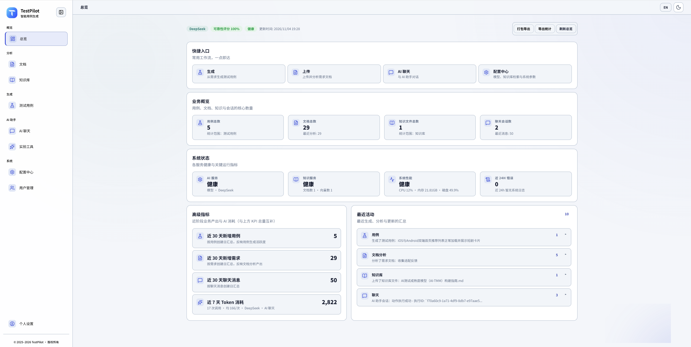
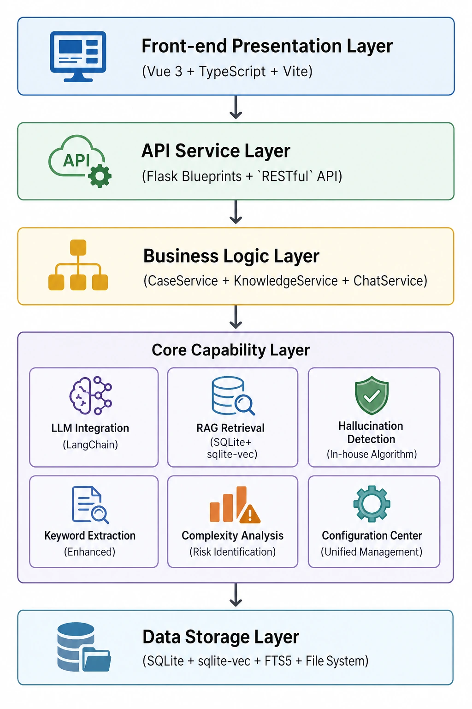
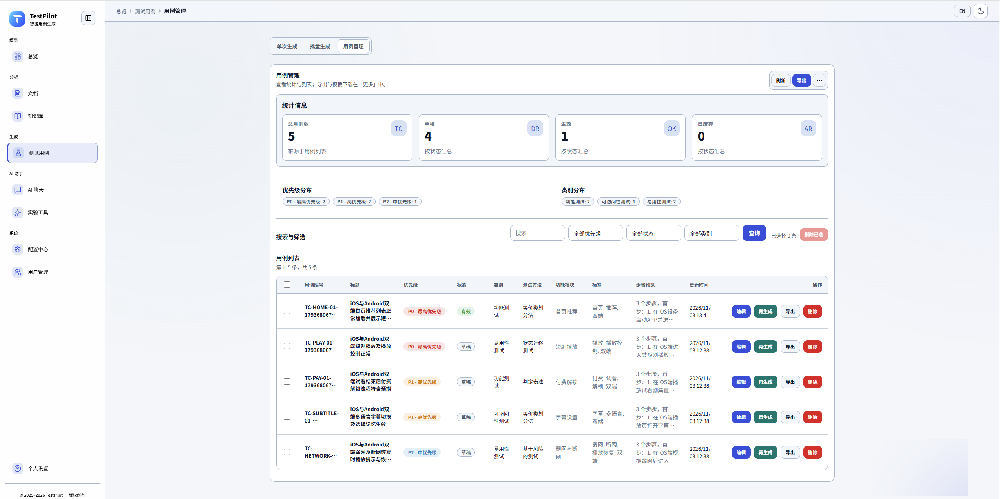
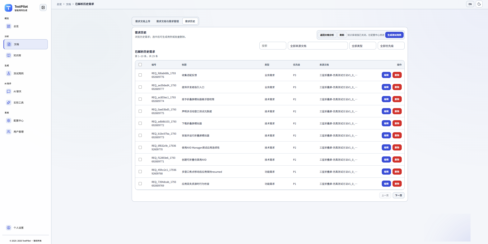
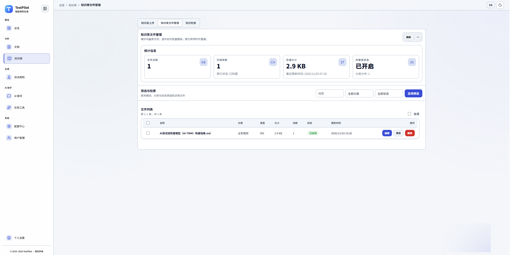
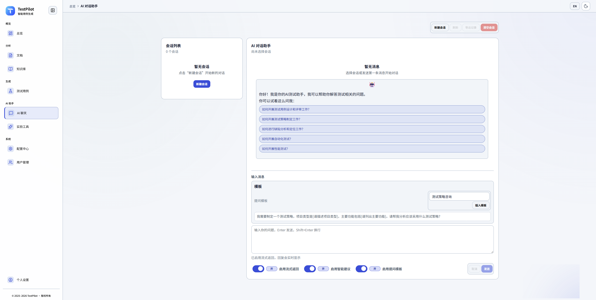
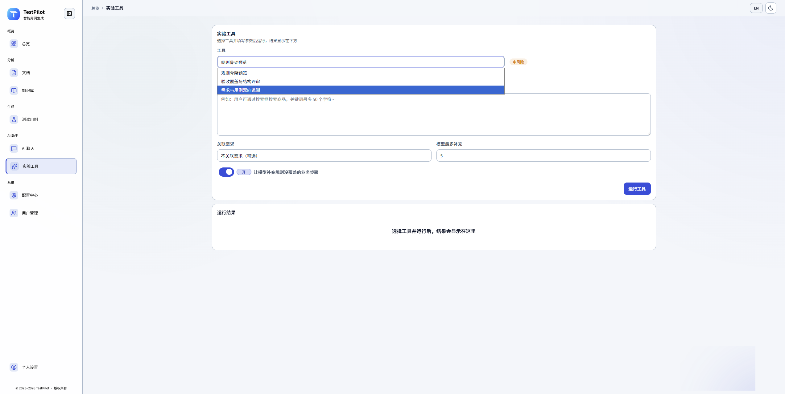
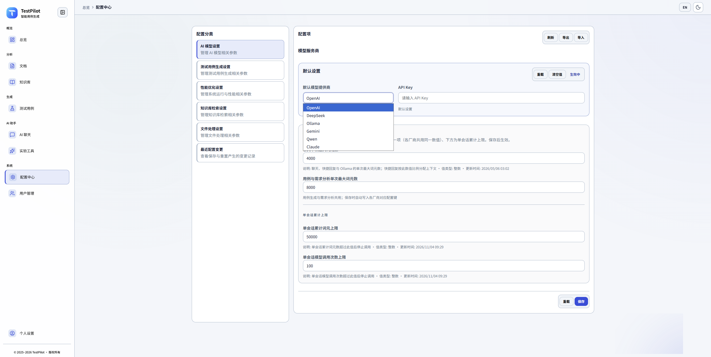
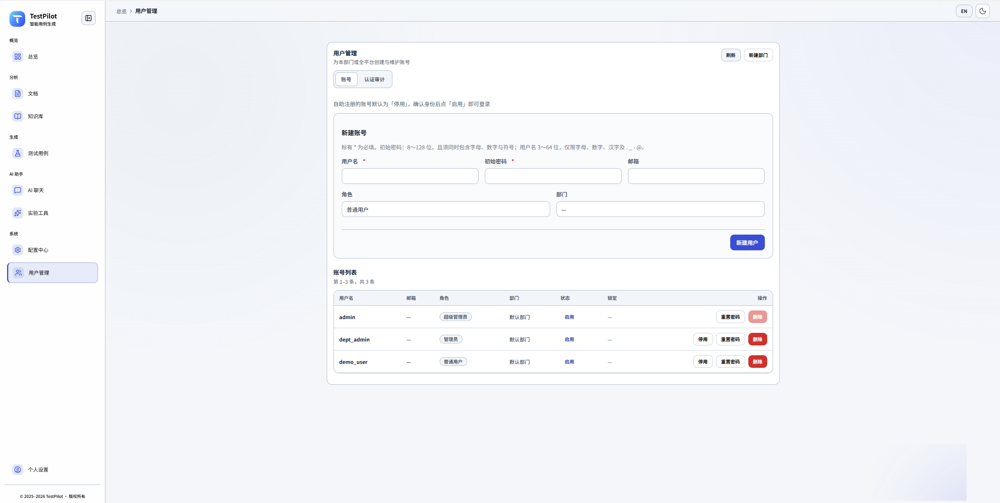

<div align="center">

# TestPilot - 智能测试用例生成和管理工具


**基于AI的智能测试用例生成和管理平台**

[](https://python.org)
[](https://flask.palletsprojects.com)
[](https://vuejs.org)
[](LICENSE)

[中文](README.md) • [English](README_en.md)

[功能特性](#功能特性) • [快速开始](#快速开始) • [认证与 RBAC](#认证与-rbac) • [部署指南](#部署指南) • [API文档](#api文档) • [贡献指南](#贡献指南)

</div>



## 项目简介

TestPilot 是一个的智能测试用例生成工具，基于大语言模型（LLM）技术，能够自动分析需求文档并生成高质量的测试用例。该工具集成了先进的幻觉检测系统，确保AI生成内容的准确性和可靠性，旨在提高软件测试效率，减少手工编写测试用例的工作量。

## 项目立项背景

### 行业背景

在软件测试领域，测试用例的编写是确保软件质量的关键环节。随着软件项目规模的不断扩大和迭代速度的加快，传统的测试用例编写方式面临着前所未有的挑战：

- **测试工作量激增**：现代软件系统功能复杂，测试场景多样，手工编写测试用例耗时巨大
- **质量要求提升**：用户对软件质量要求越来越高，需要更全面、更精准的测试覆盖
- **知识积累困难**：测试团队的经验和知识分散在各个项目中，难以有效复用
- **AI技术成熟**：大语言模型技术的快速发展为自动化测试用例生成提供了技术基础

### 项目目标

TestPilot 项目旨在通过AI技术解决测试工作中的实际痛点，构建一个智能化的测试用例生成和管理平台，实现：

1. **提升测试效率**：将测试用例生成时间从数小时缩短到数分钟
2. **保证生成质量**：通过RAG技术和幻觉检测确保生成内容的准确性和可靠性
3. **知识沉淀复用**：将历史测试经验和最佳实践转化为可检索的知识库
4. **降低测试成本**：减少重复性工作，让测试工程师专注于更高级的测试设计和分析

## 解决的实际痛点

### 1. 测试用例编写效率低

**痛点描述**：
- 传统手工编写测试用例，一个复杂需求需要数小时甚至数天
- 测试工程师需要反复阅读需求文档，理解业务逻辑
- 容易遗漏边界场景和异常情况

**解决方案**：
- 基于大语言模型自动生成测试用例，秒级完成基础用例生成
- 智能需求分析，自动提取测试要点和业务规则
- 自动生成负面用例和边界测试场景

### 2. 测试用例质量不稳定

**痛点描述**：
- 不同测试工程师编写的用例质量差异大
- 缺乏统一的测试用例标准和规范
- 用例覆盖不全面，容易遗漏关键测试点

**解决方案**：
- 基于历史测试经验和知识库的RAG增强生成
- 多策略智能检索（语义检索、关键词检索、混合检索、上下文感知检索）
- 自动复杂度分析和风险识别，推荐合适的测试类型和方法
- 幻觉检测系统确保生成内容的准确性

### 3. 历史测试经验难以复用

**痛点描述**：
- 测试团队积累的经验分散在各个项目中
- 相似需求的测试用例需要重复编写
- 无法有效利用历史测试用例和最佳实践

**解决方案**：
- 构建向量化知识库，存储历史测试用例、需求文档、测试规范等
- 智能检索系统，根据当前需求自动检索相关历史经验
- 知识库增强生成（RAG），将历史经验融入新用例生成过程

### 4. AI生成内容存在幻觉问题

**痛点描述**：
- AI模型可能生成看似合理但实际错误的内容
- 缺乏有效的质量检测机制
- 需要人工审核，增加工作量

**解决方案**：
- 自研多维度幻觉检测算法（模式匹配、逻辑分析、置信度评估）
- 自动处理策略（警告、修正、重新生成、过滤）
- 实时质量检测，确保生成内容的可靠性

### 5. 需求文档分析工作量大

**痛点描述**：
- 需求文档格式多样，解析困难
- 需要人工提取测试要点和业务规则
- 需求变更频繁，需要重新分析

**解决方案**：
- 支持多种文档格式（TXT、DOC、PDF、Markdown等）
- 智能关键词提取，支持停用词过滤和技术术语识别
- 自动提取需求要点、业务规则和约束条件
- 复杂度评估和测试工作量估算

### 6. 知识库检索效果不佳

**痛点描述**：
- 传统关键词检索无法理解语义
- 检索结果相关性差，无法有效利用知识库
- 缺乏上下文感知能力

**解决方案**：
- 多策略智能检索系统（语义检索、关键词检索、混合检索、上下文感知检索）
- 智能重排序和查询扩展
- 上下文感知检索，利用对话历史提升检索准确性
- 性能监控和优化

## 项目实现原理

### 核心技术架构

TestPilot 采用分层架构设计，结合多种先进技术实现智能化测试用例生成：



### 向量存储架构概览

**当前架构**：SQLite + sqlite-vec + FTS5（已替代 ChromaDB）

- **Embedding 层**：FastEmbed (ONNX/CPU)，无需 PyTorch
- **向量存储**：SQLite 单文件数据库 + sqlite-vec 扩展
- **全文索引**：FTS5 虚拟表（关键词召回）
- **混合检索**：FTS5 关键词召回 → sqlite-vec 向量精排（两阶段）

**优势**：
-  单文件数据库，易于部署和备份
-  无需额外服务（ChromaDB 需要独立进程）
-  轻量级（FastEmbed ONNX，无 GPU 依赖）
-  混合检索性能优于纯向量（数据量增长时）

### 1. 智能测试用例生成原理

#### 1.1 需求分析与增强

```
需求文本输入
    ↓
智能关键词提取（停用词过滤 + 技术术语识别）
    ↓
知识库检索（多策略智能检索）
    ↓
上下文增强（历史用例 + 测试规范 + 业务规则）
    ↓
复杂度分析（风险识别 + 测试类型推荐）
    ↓
LLM生成（增强提示词 + 结构化输出）
    ↓
幻觉检测（多维度检测 + 自动处理）
    ↓
测试用例输出
```

#### 1.2 RAG增强生成流程

1. **查询理解**：分析需求文本，提取核心测试要点
2. **知识检索**：
   - 语义检索：使用向量相似度搜索相关历史用例
   - 关键词检索：基于关键词匹配检索测试规范
   - 混合检索：结合语义和关键词，提升检索准确性
   - 上下文感知：利用对话历史优化检索结果
3. **结果重排序**：根据相关性得分和业务规则重排序
4. **上下文构建**：将检索结果整合为增强上下文
5. **生成优化**：将增强上下文注入LLM提示词，提升生成质量

### 2. 多策略智能检索系统

#### 2.1 检索策略

- **语义检索**：基于向量相似度，理解查询意图
- **关键词检索**：基于关键词匹配，精确查找相关内容
- **混合检索**：FTS5 关键词召回 + sqlite-vec 向量精排（两阶段）
- **上下文感知检索**：利用对话历史，动态调整检索策略

#### 2.2 混合检索详细说明（FTS5 + sqlite-vec）

**两阶段流程**：

1. **第一阶段：FTS5 关键词召回（自适应候选策略）**
   - 使用 FTS5 全文索引快速召回候选集
   - **自适应候选数量**：`fts_candidate_k = min(topK × factor, MAX_FTS_CANDIDATE_K)`
   - **Query 复杂度调节**：
     - 简单查询（token ≤ 2）：`factor *= 2`（扩大召回范围，避免遗漏）
     - 复杂查询（token ≥ 8）：`factor = max(10, factor // 2)`（缩小召回范围，减少算力浪费）
     - 中等查询：使用基础 `factor`（默认 40）
   - **FTS 命中率修正**：若实际命中 < topK，保留所有命中结果（不裁剪）

2. **第二阶段：sqlite-vec 向量精排**
   - 对候选集使用 `vec_distance_cosine` 计算向量相似度
   - 按相似度排序，返回 topK 个结果
   - **P0-1 修复**：如果候选数量 >= 999，自动分批处理（避免 SQLite IN 参数上限）
   - **自适应策略**：根据 topK 和 query 复杂度动态调整候选数量，提升检索效率

**配置项**：
- `ENABLE_HYBRID_RETRIEVAL=true`：启用混合检索（默认）
- `FTS_CANDIDATE_FACTOR=40`：自适应候选因子（基础因子，会根据 query 复杂度自动调整）
- `MAX_FTS_CANDIDATE_K=800`：FTS5 候选数量上限（安全上限）
- `FTS_CANDIDATE_K=200`：已废弃，保留用于向后兼容

**Fallback 行为**（设计行为，非 bug）：
- sqlite-vec 扩展不可用 → 自动降级到全表扫描（纯 Python 计算）
- FTS5 不可用 → 自动降级到纯向量检索
- FTS5 返回为空 → 自动降级到纯向量检索
- 所有 fallback 都有 `warning` 日志记录，不 silent fail

#### 2.3 检索优化技术

- **查询扩展**：自动提取关键词，扩展查询范围
- **智能重排序**：根据相关性、时间、重要性等多维度重排序
- **性能监控**：实时监控检索性能，自动优化策略选择

### 3. 幻觉检测系统

#### 3.1 检测维度

1. **模式匹配**：识别常见的幻觉表述模式（如"根据研究表明"等）
2. **逻辑分析**：检测内容中的逻辑矛盾和自相矛盾
3. **置信度评估**：基于多维度特征计算内容质量置信度

#### 3.2 处理策略

根据置信度阈值自动选择处理策略：

- **警告模式**（置信度 < 0.3）：仅提示用户注意
- **自动修正**（0.3 ≤ 置信度 < 0.5）：尝试自动修正
- **重新生成**（0.5 ≤ 置信度 < 0.7）：使用LLM重新生成
- **人工审核**（0.7 ≤ 置信度 < 0.9）：标记为需要人工审核
- **过滤处理**（置信度 ≥ 0.9）：直接过滤掉

### 4. 关键词提取增强

#### 4.1 提取策略

- **配置关键词**：从配置文件中获取平台、应用、功能、技术等关键词
- **直接提取**：从需求文本中直接提取技术术语、实体、名词短语
- **停用词过滤**：自动过滤无意义的停用词
- **技术术语识别**：识别测试领域专业术语

#### 4.2 应用场景

- 需求分析：提取核心概念和测试要点
- 知识检索：优化检索查询，提升检索准确性
- 用例生成：增强提示词，提升生成质量

### 5. 配置中心系统

#### 5.1 配置管理

- **统一管理**：通过 Web 界面统一管理所有配置项（见 [docs/CONFIG-CENTER.md](docs/CONFIG-CENTER.md)）
- **分类组织**：按功能模块分类（AI 模型、用例生成、知识库、性能、文件处理等）；侧栏含 **最近配置变更** 独立视图
- **配置优先级**：配置中心 > `.env` > `config/settings.py` 默认值
- **动态生效**：保存后即时生效（AI 词元等会重载 LLM / TokenMonitor，一般无需重启）
- **词元集中配置**：在 **AI 模型设置 → 单次最大词元数** 维护 `MAX_TOKENS`（聊天）、`TR_MAX_TOKENS`（用例与需求分析共用）、会话熔断 `TOKEN_MAX_*`（详见 [frontend/docs/TOKEN-CONFIG.md](frontend/docs/TOKEN-CONFIG.md)）

#### 5.2 安全特性

- **敏感信息保护**：API 密钥等敏感配置项掩码/加密存储
- **配置验证**：自动验证配置格式和必填项（`POST /api/config/validate/<key>`）
- **审计日志**：记录配置变更；配置中心侧栏 **最近配置变更** + `GET /api/config/audit-logs`

### 6. 数据流转过程

```
用户输入需求
    ↓
需求预处理（关键词提取 + 复杂度分析）
    ↓
知识库检索（多策略检索 + 结果重排序）
    ↓
上下文增强（历史用例 + 测试规范 + 业务规则）
    ↓
LLM生成（增强提示词 + 结构化输出）
    ↓
幻觉检测（多维度检测 + 置信度评估）
    ↓
自动处理（根据置信度选择处理策略）
    ↓
测试用例输出（JSON格式 + 结构化数据）
    ↓
数据存储（数据库 + 向量库 + 文件系统）
```

### 7. 技术优势

1. **智能化**：基于大语言模型和RAG技术，实现真正的智能生成
2. **高质量**：多维度幻觉检测，确保生成内容的准确性
3. **可扩展**：支持多种AI模型，灵活的配置管理
4. **高性能**：多策略检索优化，智能缓存机制
5. **易用性**：现代化UI界面，简单易用的操作流程

### 核心价值

- **智能生成**：基于AI技术自动生成测试用例，覆盖多种测试场景
- **需求分析**：智能解析需求文档，提取测试要点和业务规则
- **知识库增强**：RAG技术结合历史测试经验，多策略智能检索，提升生成质量
- **关键词提取**：智能关键词提取，支持停用词过滤和技术术语识别
- **幻觉检测**：先进的AI内容质量检测，确保生成内容的准确性和可靠性
- **配置中心**：可视化的配置管理，支持动态配置和审计日志
- **多模型支持**：支持OpenAI、Google Gemini、DeepSeek、Ollama等多种AI模型
- **现代化UI**：基于 `tp-*` 设计体系的响应式界面，支持移动端访问

## 项目框架
```text
TestPilot-vue/
├── app.py                          Flask app 工厂、蓝图注册、前端资源分发
├── run.py                          启动入口（后端 + 前端联调）
├── config/
│   ├── settings.py                 核心配置（模型、RAG、检索、实验开关）
│   ├── filter_keywords.json        关键词配置
│   └── hallucination_config.json   幻觉检测配置
├── blueprints/                     API 路由层（cases/chat/documents/knowledge/stats/config）
├── services/                       业务服务层（case/chat/document/knowledge/export/...）
├── models/                         SQLAlchemy 模型
├── utils/                          通用工具层（模型接入、检索、质量、文档处理等）
├── scripts/                        初始化、检查、维护脚本
├── tests/                          测试代码
├── frontend/                       Vue 3 + TypeScript + Vite 前端
│   ├── src/
│   │   ├── api/                    前端 API 封装
│   │   ├── components/             Vue 组件
│   │   ├── views/                  页面视图
│   │   ├── router/                 路由
│   │   ├── stores/                 Pinia 状态管理
│   │   ├── i18n/                   多语言资源（zh-CN/en）
│   │   ├── lib/                    页面/领域 UI 类（*-ui.ts）、field-control、utils
│   │   └── styles/                 tokens、Tailwind、chat-rich-content 等
│   ├── docs/UI-REDESIGN-PLAN.md    前端 UI 重设计总纲（完成定义 / 非目标 / 发版流程）
│   ├── docs/UI-MIGRATION.md        前端 UI 迁移说明（Tailwind + shadcn-vue，第 4～26 步）
│   ├── public/                     静态资源
│   └── package.json                前端依赖与脚本
├── uploads/                        上传文件目录（documents/knowledge）
├── vector_store/                   SQLite 向量库目录
├── docs/                           项目文档（含 CONFIG-CENTER、DEV-INTEGRATION）
├── README.md                       中文文档
└── README_en.md                    英文文档
```

## 功能特性

### 测试用例生成
- **智能生成**：基于需求描述自动生成测试用例
- **批量处理**：支持多个需求的批量测试用例生成
- **优先级分配**：自动分析并分配用例优先级
- **负面用例**：自动生成异常场景和边界测试用例
- **用例优化**：基于历史数据优化用例质量
- **质量检测**：自动检测生成内容中的幻觉和逻辑问题
- **关键词提取**：智能提取需求关键词，支持停用词过滤和技术术语识别
- **RAG增强**：整合知识库检索，提升用例生成质量



### 需求分析
- **文档解析**：支持多种格式文档（TXT、DOC、PDF等）
- **智能提取**：自动提取需求要点和测试点
- **关键词提取增强**：智能提取核心概念、技术术语、实体和短语
- **业务规则识别**：识别并提取业务规则和约束条件
- **复杂度评估**：评估需求复杂度和测试工作量
- **停用词过滤**：自动过滤无意义的停用词，提升关键词质量



### 知识库管理
- **文件上传**：支持多种格式的知识文件上传
- **向量化存储**：基于 SQLite + sqlite-vec + FTS5 进行向量存储和检索
- **智能检索**：多策略检索系统（语义检索、关键词检索、混合检索、上下文感知检索）
- **关键词提取增强**：智能关键词提取，支持停用词过滤、技术术语识别、实体和短语提取
- **检索优化**：智能重排序、查询扩展、性能监控
- **分类管理**：支持知识文件的分类和标签管理



### AI测试助手
- **智能对话**：专业的测试领域AI助手
- **流式响应**：支持实时流式对话体验
- **上下文记忆**：保持对话上下文，提供连续性建议
- **模板支持**：预置多种测试场景的对话模板
- **内容质量检测**：实时检测AI回复中的幻觉和逻辑问题



### 实验功能
- **规则骨架**：按验收标准生成确定性用例，可选用模型补缺口，预览确认后入库
- **验收覆盖评审**：按需求对照已关联用例，标出已覆盖项和缺口
- **双向追溯**：列出无用例的需求、悬空需求编号和未关联用例
- 默认关闭，由 `ENABLE_EXPERIMENTAL_ACTIONS` 控制；开启后从侧栏进入



### 幻觉检测系统
- **智能检测**：基于多维度算法检测AI生成内容中的幻觉问题
- **模式识别**：自动识别常见的幻觉表述模式（如"根据研究表明"等）
- **逻辑分析**：检测内容中的逻辑矛盾和自相矛盾
- **置信度评估**：科学计算内容质量置信度，提供量化评估
- **自动处理**：根据置信度自动选择处理策略（警告、修正、重新生成等）
- **详细报告**：生成完整的检测报告和改进建议

### 配置中心
- **统一配置管理**：可视化界面、分类侧栏、导出/导入（见 [docs/CONFIG-CENTER.md](docs/CONFIG-CENTER.md)）
- **配置优先级**：配置中心 > `.env` > 默认值
- **审计日志**：侧栏 **最近配置变更** + `GET /api/config/audit-logs`
- **词元配置**：AI 模型设置内 **单次最大词元数**（`MAX_TOKENS`、`TR_MAX_TOKENS`、会话熔断）
- **验证规则**：智能配置验证，确保配置正确性（如API密钥格式验证）
- **敏感信息保护**：敏感配置项加密存储，安全可靠
- **动态生效**：配置修改实时生效，无需重启服务



### 数据管理
- **多格式导出**：支持Excel、CSV、JSON等格式导出
- **数据统计**：提供详细的使用统计和分析
- **版本管理**：测试用例的版本控制和变更追踪
- **批量操作**：支持测试用例的批量编辑和管理

## 技术架构

### 后端技术栈
- **框架**：Flask 3.0+ (Python Web框架)
- **数据库**：`SQLite` / `PostgreSQL` / `MySQL` (支持多种数据库)
- **ORM**：SQLAlchemy (数据库ORM)
- **向量数据库**：SQLite + sqlite-vec + FTS5（当前默认与推荐）
- **AI集成**：LangChain (多模型AI集成框架)
- **智能检索**：多策略检索系统 (语义、关键词、混合、上下文感知)
- **关键词提取**：增强的关键词提取器 (停用词过滤、技术术语识别、实体提取)
- **幻觉检测**：自研多维度检测算法 (模式匹配、逻辑分析、置信度计算)
- **配置管理**：配置中心系统 (统一配置、审计日志、验证规则)
- **会话管理**：Flask-Session (会话状态管理)
- **异步处理**：Eventlet (异步和WebSocket支持)

### 前端技术栈
- **框架**：Vue 3 + TypeScript + Vite
- **状态与路由**：Pinia + vue-router + vue-i18n
- **UI体系**：`tp-*` 设计体系 + Vue 组件化
- **图标库**：Font Awesome 6.5 (图标支持)
- **图表库**：Chart.js (数据可视化)

### AI模型支持
- **OpenAI**：gpt-5、gpt-4o
- **Google Gemini**：gemini-3.8-flash
- **DeepSeek**：deepseek-flash（V4.1-Flash）
- **Qwen（通义千问）**：qwen-flash、qwen-plus、qwen-max
- **Ollama**：本地部署模型支持
- **自定义**：支持接入其他兼容OpenAI API的模型

## 快速开始

### 环境要求

- Python 3.10+
- Node.js 16+ (可选，用于前端开发)
- 4GB+ RAM
- 2GB+ 磁盘空间
- **重要**：项目已去 PyTorch，使用 FastEmbed (ONNX/CPU)，无需 GPU

> **注意（Git 提交）**：`models/fastembed/` 是 FastEmbed/HuggingFace 的模型缓存目录，体积较大，默认应由 `.gitignore` 忽略，不建议提交到仓库。  
> - **联网运行**：若本机缓存缺失，首次使用 embedding 时会自动下载。  
> - **离线/打包运行**：请在有网环境先执行 `python scripts/preload_fastembed_models.py` 预下载模型，并按需设置 `FASTEMBED_CACHE_DIR`。

### 安装步骤

1. **克隆项目**
```bash
git clone https://github.com/zhoujun94511/TestPilot-vue.git
cd TestPilot-vue
```

2.**创建虚拟环境**
```bash
python -m venv venv
# Windows
venv\Scripts\activate
# Linux/Mac
source venv/bin/activate
```

3.**安装依赖**
```bash
pip install -r requirements.txt
```

3.1 **初始化前端（Vue 3 + Vite）**
```bash
cd frontend
npm install
```

常用前端命令：
```bash
# 启动 Vue 开发服务（默认 Vite）
npm run dev

# 构建生产包
npm run build

# 本地预览构建结果
npm run preview
```

联调说明：
- 前端通过 `VITE_FLASK_TARGET` 连接后端（配置文件：`frontend/.env.development.local`）
- 推荐直接在项目根目录运行 `python run.py`，会自动处理后端启动与前端联调配置
- 如需独立调试前端，可手动执行 `cd frontend && npm run dev`

前端常见问题排查：
- `npm install` 失败：先确认 Node.js 版本（建议 18+），再执行 `npm cache clean --force` 后重试
- `npm run dev` 启动报端口占用：按终端提示更换端口，或先释放占用端口进程
- 页面接口请求失败：检查 `frontend/.env.development.local` 中 `VITE_FLASK_TARGET` 是否指向正确后端地址
- 页面空白/资源 404：删除 `frontend/node_modules` 后重新 `npm install`，再执行 `npm run dev`
- 联调跨域异常：优先使用 `python run.py` 启动，确保后端 CORS 与前端目标地址一致

**注意**：项目已移除 PyTorch、sentence-transformers、transformers 依赖，使用轻量级 FastEmbed (ONNX)。

4**预下载 Embedding 模型（离线部署必需）**

 **首次部署必须预下载模型，否则会隐式访问外网**

```bash
# 下载默认模型（BAAI bge-small-en-v1.5，维度 384）
python scripts/preload_fastembed_models.py

# 或指定模型（BAAI）
python scripts/preload_fastembed_models.py --model baai/bge-base-en-v1.5

# 指定缓存目录（可选）
export FASTEMBED_CACHE_DIR=/path/to/cache
python scripts/preload_fastembed_models.py
```

**离线部署**：如果目标环境无外网，可在有网环境预下载后，将缓存目录（默认 `~/.cache/fastembed`）复制到目标环境，并设置 `FASTEMBED_CACHE_DIR` 环境变量。

5.**配置环境变量**
```bash
cp .env.example .env
# 编辑 .env 文件，配置必要的环境变量
```

**认证相关（团队/多用户部署建议阅读 [docs/AUTH-RBAC.md](docs/AUTH-RBAC.md)）**：

```bash
# 默认 false：不强制登录（单机兼容）。生产/团队环境建议 true
AUTH_REQUIRE_AUTH=false
AUTH_REGISTER_ENABLED=false
# 开放注册时，新账号默认停用，管理员启用后才能登录
AUTH_REGISTER_REQUIRE_APPROVAL=true
# 只有部署在可信反向代理之后才开启
AUTH_TRUST_PROXY_HEADERS=false
# 仅 users 表为空时创建引导 super_admin，默认用户名 admin
AUTH_BOOTSTRAP_SUPER_USERNAME=admin
# 务必设置强密码；留空时首次启动会使用默认密码 TestPilot@2026（日志告警）
AUTH_BOOTSTRAP_SUPER_PASSWORD=
```

6.**初始化数据库**
```bash
python scripts/init_db.py init
# 或无参数：python scripts/init_db.py
# 会通过 create_app 执行 RBAC 列迁移；空库时自动创建引导 super_admin
```

**开发可选**：创建演示部门管理员与普通用户（非出厂账号）：

```bash
python scripts/seed_demo_users.py
```

7.**（可选）启用强制登录后**：浏览器访问前端，使用引导超管登录，在 **用户管理** 中为各部门创建 admin / user；或通过 API `POST /api/auth/users`（需 super_admin / 本部门 admin）。

**关键配置项**（向量存储相关，当前默认使用 SQLite + sqlite-vec，ChromaDB 已废弃，仅保留回滚兼容）：
```bash
# 向量存储后端（默认 sqlite，历史上支持 sqlite/chroma，当前推荐仅使用 sqlite）
VECTOR_BACKEND=sqlite

# Embedding 模型配置（必须与实际模型一致）
EMBEDDING_MODEL_NAME=baai/bge-small-en-v1.5
EMBEDDING_DIM=384  # 重要：维度一旦确定，不允许再变更（sqlite-vec 要求）

# SQLite 向量存储配置（可选）
SQLITE_VECTOR_DB_PATH=  # 如果为空，使用 vector_store/vector_store.db
SQLITE_VEC_EXTENSION_PATH=  # sqlite-vec 扩展路径（可选，未设置时自动尝试加载）

# 混合检索配置
ENABLE_HYBRID_RETRIEVAL=true  # 是否启用混合检索（FTS5 + sqlite-vec）
FTS_CANDIDATE_K=200  # FTS5 召回候选数量（默认 200，适用于 topK=5~10）
```

8.**初始化向量数据库（SQLite 向量存储）**

向量数据库会在首次使用时自动初始化，但也可以手动初始化：

```bash
# 初始化向量数据库（清空所有数据，保留数据库结构）
python scripts/init_vectordb.py --init-vector-db

# 或预览初始化（不实际执行）
python scripts/init_vectordb.py --init-vector-db --dry-run
```

**说明**：
- SQLite 向量数据库文件默认位置：`vector_store/vector_store.db`
- 数据库包含以下表：
  - `documents`：文档元数据
  - `chunks`：文档块
  - `chunk_embeddings`：向量数据（BLOB 格式，float32 buffer）
  - `chunk_fts`：FTS5 全文索引（虚拟表）
- vec0 虚拟表：当前实现直接使用 `chunk_embeddings` 表 + `vec_distance_cosine` 函数，不再维护单独的虚拟表

9.**初始化配置中心**（建议，含 `TR_MAX_TOKENS` 与审计相关迁移）
```bash
python scripts/init_config_center.py
```

10.**启动应用**
```bash
python run.py
```

11.**访问应用**
```
打开浏览器访问: http://localhost:5000
```

**注意**：首次使用建议先访问配置中心配置AI模型API密钥。

### 清空本地数据（提交前或重置环境）

先停止后端，再执行：

```bash
# 业务库：清空 testpilot.db 全部表数据（保留表结构），含配置中心三张表和用户/部门
python scripts/init_db.py clear
# 向量库：清空 vector_store/vector_store.db 中的文档、chunk、向量和 FTS 索引
python scripts/init_vectordb.py --clear-vector-db
```

| 脚本 | 清空内容 | 清空后的行为 |
|------|----------|--------------|
| `init_db.py clear` | 用例、需求、聊天会话与历史、工具执行审计、模型用量、系统日志、性能指标、知识文件记录、配置中心（配置项、验证规则、变更审计）、用户、登录会话、认证审计、部门 | 下次启动自动重建默认部门和引导超管 `admin`；配置中心为空时回退 `.env` |
| `init_vectordb.py --clear-vector-db` | 全部向量数据 | 知识库检索和 RAG 无结果，需重新上传知识文件 |
| `init_config_center.py --force` | 仅配置中心的配置项和验证规则，随后写入脚本内置默认值 | 内置默认 `DEFAULT_COMPANY=OPENAI`，会覆盖 `.env` 的提供商，只在需要恢复出厂配置时使用 |

两个清空命令都会要求输入 `y` 确认，并且只删除行、保留表结构。`init_db.py clear` 结束时会执行 VACUUM 收缩数据库文件。提交前再删除 `uploads/`、`downloads/`、`logs/` 里面的文件，目录本身保留。这三项目录已写入 `.gitignore`，不会被提交。

### 离线部署完整流程

1. **在有网环境预下载模型**
```bash
python scripts/preload_fastembed_models.py
```

1. **复制缓存目录到目标环境**
```bash
# 源环境
cp -r ~/.cache/fastembed /path/to/offline/cache

# 目标环境
export FASTEMBED_CACHE_DIR=/path/to/offline/cache
```

1.**安装依赖（无需外网）**
```bash
pip install -r requirements.txt
```

1.**初始化数据库和向量库**
```bash
python scripts/init_db.py
python scripts/init_vectordb.py --init-vector-db
```

1.**启动应用**
```bash
python run.py
```

## 配置说明

### 配置管理

TestPilot 支持两种配置方式：

#### 1. 环境变量配置（.env文件）

主要的环境变量配置项：

```bash
# Flask应用配置
FLASK_ENV=development
DEBUG=True
SECRET_KEY=your-secret-key

# 数据库配置
DATABASE_URL=sqlite:///testpilot.db

# AI模型配置
OPENAI_API_KEY=your-openai-key
DEFAULT_COMPANY=OPENAI  # 默认使用的AI提供商（统一使用大写）

# 文件上传配置
MAX_CONTENT_LENGTH=16777216  # 16MB
UPLOAD_FOLDER=uploads

# ===========================================
# 向量存储配置（新增）
# ===========================================

# 向量库总开关（默认 true）。设为 false 时不加载 sqlite-vec/FTS5，无对应库也可运行，便于 PyInstaller 等打包缩减体积；知识库与 RAG 功能不可用
ENABLE_VECTOR_STORE=true

# 向量存储后端（默认 sqlite，历史上支持 sqlite/chroma，当前推荐仅使用 sqlite）
VECTOR_BACKEND=sqlite  # 不建议再使用 chroma，ChromaDB 逻辑已废弃，仅老版本回滚时使用

# SQLite 向量存储配置
SQLITE_VECTOR_DB_PATH=  # 如果为空，使用 vector_store/vector_store.db
SQLITE_VEC_EXTENSION_PATH=  # sqlite-vec 扩展路径（可选）

# Embedding 模型配置（FastEmbed）
EMBEDDING_MODEL_NAME=baai/bge-small-en-v1.5  # FastEmbed 模型名称
EMBEDDING_DIM=384  # 重要：维度一旦确定，不允许再变更（sqlite-vec 要求）
FASTEMBED_CACHE_DIR=  # FastEmbed 模型缓存目录（可选，默认 ~/.cache/fastembed）

# 混合检索配置（FTS5 + sqlite-vec）
ENABLE_HYBRID_RETRIEVAL=true  # 是否启用混合检索
FTS_CANDIDATE_FACTOR=40  # 自适应候选因子（默认 40，对应 topK × 40）
MAX_FTS_CANDIDATE_K=800  # FTS5 候选数量上限（安全上限，避免 SQLite IN 参数问题）
FTS_CANDIDATE_K=200  # FTS5 召回候选数量（已废弃，保留用于向后兼容）
# 自适应策略说明：
# - 基础公式：fts_candidate_k = min(topK × FTS_CANDIDATE_FACTOR, MAX_FTS_CANDIDATE_K)
# - Query 复杂度调节：简单查询（token ≤ 2）扩大召回，复杂查询（token ≥ 8）缩小召回
# - 示例：
#   - topK=5, 中等查询 → 5 × 40 = 200
#   - topK=5, 简单查询 → 5 × 80 = 400
#   - topK=10, 复杂查询 → 10 × 20 = 200

# ChromaDB配置（仅老版本回滚兼容使用，正常情况下可忽略）
# 仅当 VECTOR_BACKEND=chroma 且需要回滚到旧版 ChromaDB 存储时才需要关注
CHROMADB_PERSIST_DIRECTORY=vector_store

# RAG检索配置
RAG_TOP_K=5
RAG_SCORE_THRESHOLD=0.7
RAG_ENABLE_KEYWORD_FILTER=true

# 智能检索配置
ENABLE_SMART_RETRIEVAL=true
RETRIEVAL_STRATEGY=hybrid  # semantic, keyword, hybrid, context_aware

# 幻觉检测配置
ENABLE_HALLUCINATION_DETECTION=true
HALLUCINATION_SIMILARITY_THRESHOLD=0.8
HALLUCINATION_CONFIDENCE_THRESHOLD=0.7
HALLUCINATION_WARN_THRESHOLD=0.3
HALLUCINATION_AUTO_CORRECT_THRESHOLD=0.5
HALLUCINATION_REGENERATE_THRESHOLD=0.7
HALLUCINATION_FILTER_THRESHOLD=0.9

# 实验动作编排（默认关闭，建议仅测试环境开启）
ENABLE_EXPERIMENTAL_ACTIONS=false
```

详细配置请参考 `.env.example` 文件。

### 向量存储配置矩阵

| 配置键                         | 默认值                            | 影响              | 说明                                                                                         |
|-----------------------------|--------------------------------|-----------------|--------------------------------------------------------------------------------------------|
| `ENABLE_VECTOR_STORE`       | `true`                         | 向量库总开关          | `false`：不加载 sqlite-vec/FTS5，无对应库也可运行；知识库与 RAG 不可用。**打包（如 PyInstaller）时可设为 `false` 以缩减体积**  |
| `VECTOR_BACKEND`            | `sqlite`                       | 向量存储后端          | `sqlite`：使用 SQLite + sqlite-vec（当前默认且推荐）<br>`chroma`：使用 ChromaDB（**已废弃，不推荐使用，仅老版本回滚场景保留**） |
| `EMBEDDING_MODEL_NAME`      | `baai/bge-small-en-v1.5`       | Embedding 模型    | FastEmbed 模型名称，必须与 `EMBEDDING_DIM` 一致                                                      |
| `EMBEDDING_DIM`             | `384`                          | Embedding 维度    | **重要**：维度一旦确定，不允许再变更（sqlite-vec 要求）<br>变更维度需要重建向量库                                         |
| `FASTEMBED_CACHE_DIR`       | `~/.cache/fastembed`           | 模型缓存目录          | 离线部署时，可指定自定义缓存目录                                                                           |
| `SQLITE_VECTOR_DB_PATH`     | `vector_store/vector_store.db` | SQLite 数据库路径    | 如果为空，使用默认路径                                                                                |
| `SQLITE_VEC_EXTENSION_PATH` | `''`                           | sqlite-vec 扩展路径 | 可选，未设置时自动尝试从常见位置加载                                                                         |
| `ENABLE_HYBRID_RETRIEVAL`   | `true`                         | 混合检索开关          | `true`：启用 FTS5 + sqlite-vec 混合检索<br>`false`：仅使用纯向量检索                                       |
| `FTS_CANDIDATE_FACTOR`      | `40`                           | 自适应候选因子         | 基础因子，用于计算 `fts_candidate_k = topK × factor`<br>会根据 query 复杂度自动调整（简单查询 ×2，复杂查询 ÷2）          |
| `MAX_FTS_CANDIDATE_K`       | `800`                          | FTS5 候选数量上限     | 安全上限，避免 SQLite IN 参数问题                                                                     |
| `FTS_CANDIDATE_K`           | `200`                          | FTS5 候选数量（已废弃）  | 保留用于向后兼容，实际使用自适应策略                                                                         |

### 实验动作编排说明（低耦合、可拆卸）

- 默认关闭：`ENABLE_EXPERIMENTAL_ACTIONS=false` 时实验接口返回 403（蓝图仍注册，便于按需开启）；普通 Chat 模式不受影响
- 独立模块：实现位于 `experiments/action_runtime`，不侵入核心业务服务
- 安全机制：
  - 会写入库的动作先预览，确认时按已保存的预览入库，不重新调用模型
  - 确认限于发起人或管理员
  - 实验接口带轻量限流保护（每 60 秒最多 12 次/调用方）
- 审计追踪：所有动作写入 `tool_execution_logs`，可按 `execution_id` 查询详情

### 检索模式说明

#### 1. 纯向量检索

**配置**：`ENABLE_HYBRID_RETRIEVAL=false`

**流程**：
- 直接使用 sqlite-vec 对全量数据进行向量相似度搜索
- 返回 topK 个最相似的文档

**适用场景**：
- 数据量较小（< 10万条）
- 关键词匹配不重要的场景

#### 2. 混合检索（FTS5 + sqlite-vec）

**配置**：`ENABLE_HYBRID_RETRIEVAL=true`（默认）

**流程**：
1. **第一阶段**：FTS5 关键词召回候选集（自适应候选数量，根据 topK 和 query 复杂度动态计算）
2. **第二阶段**：sqlite-vec 对候选集做向量精排，返回 topK 个

**优势**：
- 关键词召回：快速过滤不相关文档
- 向量精排：只计算候选集的相似度，性能优于纯向量（数据量增长时）

**适用场景**：
- 数据量较大（> 10万条）
- 需要关键词匹配的场景

#### 3. Fallback 行为

**自动降级机制**（可预期）：
- sqlite-vec 扩展不可用 → 自动降级到全表扫描（纯 Python 计算）
- FTS5 不可用 → 自动降级到纯向量检索
- FTS5 返回为空 → 自动降级到纯向量检索
- 所有 fallback 都有 `warning` 日志记录，不 silent fail

**验证 fallback**：
```bash
# 查看日志，确认 fallback 状态
grep "降级\|fallback\|warning" logs/testpilot_*.log
```

#### 2. 配置中心（Web界面）

TestPilot 提供了可视化的配置中心，支持：

- **统一管理**：通过 Web 界面管理所有配置项
- **分类组织**：按功能模块分类；**最近配置变更** 为独立侧栏项
- **实时生效**：保存后即时生效（词元等触发热重载）
- **审计日志**：`GET /api/config/audit-logs`，配置中心内只读浏览
- **配置验证**：自动验证格式与必填项
- **词元分区**：AI 模型设置 → **单次最大词元数**（详见 TOKEN-CONFIG.md）

**配置优先级**：配置中心 > `.env` > 默认值

**文档**：[docs/CONFIG-CENTER.md](docs/CONFIG-CENTER.md)、词元说明 [frontend/docs/TOKEN-CONFIG.md](frontend/docs/TOKEN-CONFIG.md)

**初始化配置中心**：
```bash
python scripts/init_config_center.py
```

### AI模型配置

TestPilot支持多种AI模型，配置示例：

```bash
# OpenAI
DEFAULT_COMPANY=OPENAI
OPENAI_API_KEY=sk-your-openai-key
OPENAI_MODEL=gpt-5

# Google Gemini
DEFAULT_COMPANY=GEMINI
GEMINI_API_KEY=your-gemini-api-key
GEMINI_MODEL=gemini-3.8-flash

# DeepSeek
DEFAULT_COMPANY=DEEPSEEK
DEEPSEEK_API_KEY=your-deepseek-key
DEEPSEEK_MODEL=deepseek-flash

# Qwen
DEFAULT_COMPANY=QWEN
QWEN_API_KEY=your-qwen-api-key
QWEN_BASE_URL=https://dashscope.aliyuncs.com/compatible-mode/v1
QWEN_MODEL=qwen-flash
QWEN_TEMPERATURE=0.7
QWEN_TIMEOUT=60

# 词元（冷启动默认；运行期请在配置中心维护 TR_MAX_TOKENS / MAX_TOKENS）
TR_MAX_TOKENS=8000
MAX_TOKENS=4000
TOKEN_MAX_PER_SESSION=50000
TOKEN_MAX_CALLS_PER_SESSION=100

# Ollama (本地部署)
DEFAULT_COMPANY=OLLAMA
OLLAMA_BASE_URL=http://localhost:11434
OLLAMA_MODEL=llama2
```

## 使用指南

### 1. 测试用例生成

1. **单个需求生成**
   - 在"用例生成"页面输入需求描述
   - 设置生成参数（数量、优先级等）
   - 点击"生成测试用例"

2. **批量生成**
   - 点击"批量生成"按钮
   - 输入多个需求（每行一个）
   - 设置批量处理参数

3. **高级选项**
   - 启用RAG增强：使用知识库优化生成质量
   - 包含负面用例：生成异常和边界测试场景
   - 自动优化：基于历史数据优化用例
   - 幻觉检测：自动检测并处理生成内容中的质量问题

### 2. 需求分析

1. **文档上传**
   - 选择"文件上传"方式
   - 上传需求文档（支持多种格式）
   - 选择分析类型并执行分析

2. **文本分析**
   - 选择"文本输入"方式
   - 直接粘贴需求文本
   - 执行智能分析

### 3. 知识库管理

1. **文件上传**
   - 选择知识文件并设置分类
   - 添加文件描述
   - 上传到知识库

2. **智能检索**
   - 输入搜索关键词或问题
   - 系统自动选择最佳检索策略（语义/关键词/混合/上下文感知）
   - 查看检索结果和相关性评分
   - 支持查看原文和上下文信息

3. **检索优化**
   - 智能重排序：根据相关性自动排序结果
   - 查询扩展：自动提取关键词扩展查询
   - 上下文感知：利用对话上下文提升检索准确性

### 4. AI助手对话

1. **开始对话**
   - 在聊天界面输入问题
   - 选择是否使用上下文和知识库
   - 获取AI助手的专业建议

2. **使用模板**
   - 选择预置的对话模板
   - 根据提示填写相关信息
   - 获取针对性的建议

### 5. 幻觉检测功能

1. **自动检测**
   - 系统会自动检测AI生成内容中的幻觉问题
   - 支持模式匹配、逻辑分析、置信度评估
   - 实时显示检测结果和处理建议

2. **处理策略**
   - 警告模式：低置信度问题，仅提示用户注意
   - 自动修正：中等置信度问题，尝试自动修正
   - 重新生成：高置信度问题，使用LLM重新生成
   - 人工审核：严重问题，标记为需要人工审核
   - 过滤处理：极严重问题，直接过滤掉

3. **配置管理**
   - 可在配置中心调整检测阈值
   - 支持启用/禁用幻觉检测功能
   - 可自定义处理策略和阈值参数

### 6. 配置中心管理

1. **访问配置中心**
   - 导航栏进入 **配置中心**
   - 左侧切换分类；**最近配置变更** 为只读审计列表（独立页面布局）

2. **配置管理**
   - 按分类编辑并保存（支持 dirty 提示、顶栏刷新）
   - **AI 模型设置**：Provider 开关与密钥；**单次最大词元数** 分区（聊天 / 用例与需求 / 会话熔断）
   - 导出、导入（审计页不提供）
   - 校验失败时字段级或 Toast 提示

3. **配置优先级**
   - 配置中心 > `.env` > 系统默认值

4. **敏感配置**
   - API 密钥等掩码显示，可切换显示明文

详细 API 与初始化见 [docs/CONFIG-CENTER.md](docs/CONFIG-CENTER.md)。

## API文档

### 主要API端点

#### 测试用例相关
- `POST /api/cases/generate` - 生成测试用例
- `GET /api/cases` - 获取测试用例列表
- `GET /api/cases/{id}` - 获取单个测试用例
- `PUT /api/cases/{id}` - 更新测试用例
- `DELETE /api/cases/{id}` - 删除测试用例

#### 需求分析相关
- `POST /api/documents/upload` - 上传文档
- `POST /api/documents/analyze` - 分析内容
- `GET /api/documents` - 获取文档列表
- `GET /api/requirements` - 获取需求列表

#### 知识库相关
- `POST /api/knowledge/upload` - 上传知识文件
- `POST /api/knowledge/search` - 搜索知识库
- `GET /api/knowledge/files` - 获取文件列表
- `DELETE /api/knowledge/files/{id}` - 删除知识文件

#### 聊天相关
- `POST /api/chat/sessions` - 创建聊天会话
- `POST /api/chat/message` - 发送消息
- `GET /api/chat/sessions` - 获取会话列表
- `GET /api/chat/history/{session_id}` - 获取聊天历史

#### 实验动作编排（可选，默认关闭）
需设置环境变量 `ENABLE_EXPERIMENTAL_ACTIONS=true` 后上述接口才可用（否则 403）。

**与聊天通道分离（不兼容旧客户端）**：`/api/chat/message` 与 `/api/chat/stream` 仅支持 `mode=chat`；`mode=action` 一律 **400** `action_mode_not_supported`，响应体含 `experimental_actions.execute` 等指引。对话与智能建议走 LLM；工具请走下方 execute，**必须**显式 `tool_name` + `args`（侧栏「实验工具」页 `/experimental-tools`）。默认 **关闭** NL 推断（无 `tool_name` → 400 `explicit_tool_required`）；脚本调试可设 `EXPERIMENTAL_ACTIONS_ALLOW_NL=true`，此时模糊句可能 `skipped` 而非误执行 list。

- `GET /api/experimental-actions/health` - 查询实验动作能力状态与已注册工具
- `POST /api/experimental-actions/execute` - 执行动作（显式 `tool_name`/`args` 或 NL 推断；高风险默认待确认；`done`/`failed` 且带 `session_id` 时会写入聊天历史）
- `POST /api/experimental-actions/confirm` - 确认执行待确认动作
- `POST /api/experimental-actions/cancel` - 取消待确认动作
- `GET /api/experimental-actions/execution/{execution_id}` - 查询执行详情与审计状态

**维护约定**：后端工具在 `experiments/action_runtime/orchestrator.py` 注册；实验工具页表单在 `frontend/src/config/experimentalTools.ts`，页面为 `frontend/src/views/ExperimentalToolsView.vue`。新增/改名工具须两处同步，否则 execute 可能返回 `unknown_tool` 或页面缺字段。非法 `tool_name` 在显式模式下返回 **400** `unknown_tool`，且 **不会** 回退 NL 推断。

**怎么用（测试同学生路径）**

1. 后端 `ENABLE_EXPERIMENTAL_ACTIONS=true`。侧栏「AI 助手」分组里，「实验工具」在「AI 聊天」下方，所有已登录用户可见（未配置角色限制）。后端未开启时页面会提示不可用，入口仍在。
2. **日常讨论**：在 AI 聊天页用输入框或智能建议，走 LLM 对话（不会自动列库内用例）。
3. **真要落库或列出数据**：打开侧栏「实验工具」，选工具后点「运行工具」。
   - 「列出用例」等：多数可直接运行（已有默认条数）。
   - 「生成用例」：在「需求描述」里填写需求，再 **运行工具**。切换到「分析文档内容」时已填的长文本会自动带过去。
   - 聊天页智能建议含「设计/生成 + 用例」时：普通点击仍 **发送对话**；**Shift+点击** 跳到实验工具页并预填「生成用例」，不发送对话。
4. 删除用例等高风险操作：运行后在同页确认，并输入 `DELETE`。

#### 导出相关
- `GET /api/export/cases` - 导出测试用例
- `GET /api/export/requirements` - 导出需求
- `GET /api/export/template/{type}` - 获取导出模板

#### 幻觉检测相关
- `POST /api/hallucination/detect` - 检测内容中的幻觉问题
- `GET /api/hallucination/report/{id}` - 获取检测报告
- `POST /api/hallucination/handle` - 处理检测到的幻觉问题
- `GET /api/hallucination/config` - 获取幻觉检测配置

#### 配置中心相关
- `GET /api/config/categories` - 获取配置分类
- `GET /api/config/<category>` - 获取指定分类的配置
- `POST /api/config/<category>` - 批量更新指定分类的配置
- `GET /api/config/item/<key>` - 获取单个配置项
- `PUT /api/config/item/<key>` - 更新单个配置项
- `DELETE /api/config/item/<key>` - 删除配置项
- `GET /api/config/export` - 导出配置
- `POST /api/config/import` - 导入配置
- `GET /api/config/audit-logs` - 获取配置审计日志
- `POST /api/config/validate/<key>` - 校验配置项

#### 统计相关
- `GET /api/stats/overview` - 获取概览统计
- `GET /api/stats/performance` - 获取性能指标
- `GET /api/stats/health` - 健康检查

详细的API文档请参考 `/docs` 目录或在线文档。

## 测试

### 运行系统测试

```bash
# 启动应用后运行测试
python scripts/test_system.py

# 指定测试目标（也可跳过，项目已支持启动时自动打开对应网页）
python scripts/test_system.py http://localhost:5001
```

### 运行向量存储白盒测试

```bash
# 进入测试目录
cd tests/vector_pipeline

# 设置环境变量（必需）
export EMBEDDING_MODEL_NAME=baai/bge-small-en-v1.5
export EMBEDDING_DIM=384
export VECTOR_BACKEND=sqlite
export ENABLE_HYBRID_RETRIEVAL=true
export FTS_CANDIDATE_K=200

# 运行测试（Windows）
run_tests.bat

# 运行测试（Linux/Mac）
chmod +x run_tests.sh
./run_tests.sh

# 或使用 pytest 直接运行
pytest tests/vector_pipeline/ -v
```

**测试覆盖**：
-  sqlite-vec 索引创建和查询
-  FTS5 全文索引创建和查询
-  混合检索两阶段流程
-  **雷点 1**：SQLite IN 参数上限（FTS_CANDIDATE_K ∈ [950, 999]）
-  **雷点 2**：embedding buffer 长度校验（len(buffer) == dim * 4）
-  **雷点 3**：FTS 与 chunks 一致性（无幽灵数据）
-  Fallback 路径（扩展不可用时的行为）

### 测试覆盖范围

-  健康检查
-  页面访问
-  静态文件加载
-  API端点检查
-  测试用例生成
-  需求分析
-  知识库管理
-  AI助手对话
-  幻觉检测功能
-  配置中心管理
-  智能检索策略
-  关键词提取增强
-  数据导出
-  统计功能
- **向量存储**（SQLite + sqlite-vec + FTS5）

### 幻觉检测测试

```bash
# 运行幻觉检测功能测试
python scripts/test_chat_hallucination.py

# 运行完整的白盒测试
python scripts/run_hallucination_tests.py --full

# 运行快速测试
python scripts/run_hallucination_tests.py --quick
```

## 认证与 RBAC

TestPilot 支持可选的登录与 **部门级数据隔离**（用例、需求、知识库、聊天、导出、统计等）。默认 **`AUTH_REQUIRE_AUTH=false`**，与单机匿名使用兼容；团队或生产环境请在 `.env` 中开启并阅读完整说明。

| 项目 | 说明 |
|------|------|
| 详细文档 | [docs/AUTH-RBAC.md](docs/AUTH-RBAC.md) |
| 引导超管 | 空库首次迁移后自动创建，默认用户名 `admin`，密码见 `AUTH_BOOTSTRAP_SUPER_PASSWORD`（未设置时为 `TestPilot@2026`） |
| 部门 admin / user | **不预置**；超管在 **用户管理** 创建，或开发环境运行 `python scripts/seed_demo_users.py` |
| 数据库迁移 | 启动或 `python scripts/init_db.py init` → `run_auth_migrations()` |
| 前端 | 登录页 + `/admin/users`（admin/super_admin）；配置中心仅 super_admin |

生产请务必：设置强引导密码、开启 `AUTH_REQUIRE_AUTH`、关闭或审慎使用 `AUTH_REGISTER_ENABLED`。




## 部署指南

### 生产环境部署

1. **环境准备**
```bash
# 设置生产环境变量
export FLASK_ENV=production
export DEBUG=False
export SECRET_KEY=your-production-secret-key
```

1. **使用Gunicorn部署**
```bash
gunicorn --bind 0.0.0.0:5001 --workers 4 --worker-class eventlet app:create_app()
```

### 云平台部署

支持部署到各大云平台：
- **AWS**: ECS, Lambda, EC2
- **Azure**: Container Instances, App Service
- **Google Cloud**: Cloud Run, Compute Engine
- **阿里云**: ECS, 函数计算
- **腾讯云**: CVM, 云函数

## 已知工程限制

### 1. Embedding 维度不可变

**重要约束**：`EMBEDDING_DIM` 一旦确定，不允许再变更（sqlite-vec 要求）

**原因**：向量数据库的 schema 依赖维度，变更维度会导致数据不兼容

**解决方法**：
- 变更维度前，必须重建向量库：
  ```bash
  python scripts/init_vectordb.py --init-vector-db
  ```
- 确保 `EMBEDDING_DIM` 与实际模型维度一致（启动时会自动校验）

### 2. SQLite IN 参数上限（已修复）

**已知限制**：SQLite 默认 IN 参数上限为 999

**影响**：如果 `FTS_CANDIDATE_K >= 999`，混合检索第二阶段可能触发上限

**已修复**（P0-1）：
- 自动检测候选数量 >= 999
- 自动分批处理（批次大小 800）
- 合并结果后统一排序
- 有明确的 `warning` 日志记录

**建议**：保持 `FTS_CANDIDATE_K < 999`（默认 200 是安全的）

### 3. sqlite-vec 扩展依赖

**可选依赖**：sqlite-vec 扩展用于向量索引加速

**行为**：
- 扩展可用：使用 `vec_distance_cosine` 函数（高性能）
- 扩展不可用：自动降级到全表扫描（纯 Python 计算，性能较差但可用）

**扩展加载**：
- 自动尝试从常见位置加载（`/usr/local/lib/vec0.so` 等）
- 可通过 `SQLITE_VEC_EXTENSION_PATH` 指定扩展路径
- 加载失败不影响功能，仅影响性能

**说明**：这是"设计行为"，不是 bug。系统设计为在扩展不可用时自动降级，确保功能可用。

### 4. FTS5 与 chunks 一致性

**已知风险**：FTS5 是虚拟表，不 enforce 外键约束

**已修复**（P0-2）：
- `delete()` 方法中同时删除 FTS5 数据（事务保证）
- 提供 `_verify_fts_chunks_consistency()` 调试工具（检测幽灵数据）
- 删除后自动验证一致性（仅记录 warning，不影响主流程）

**说明**：FTS5 虚拟表没有外键约束，但通过事务和同步删除保证一致性。

### 5. distance → similarity_score 映射假设

**映射假设**：当前实现假设 `vec_distance_cosine` 返回范围 [0, 2]

**映射公式**：
```text
similarity = max(0.0, 1.0 - distance / 2.0)
# distance = 0 → similarity = 1.0（最相似）
# distance = 2 → similarity = 0.0（最不相似）
```

**注意**：
- 如果未来升级 sqlite-vec 版本，需要验证 distance 范围是否仍为 [0, 2]
- 如果范围变化，需要调整映射公式
- 建议在初始化时测试 distance 范围并记录日志

## 故障排除

### 常见问题

1. **应用启动失败**
   - 检查Python版本（需要3.10+）
   - 确认所有依赖已正确安装
   - 检查环境变量配置

2.**Embedding 模型加载失败**

**错误**：`维度不匹配！配置维度 (EMBEDDING_DIM): 384, 实际模型维度: 768`

**原因**：配置的 `EMBEDDING_DIM` 与实际模型维度不一致

**解决方法**：
```bash
# 方法1：修改 EMBEDDING_DIM 环境变量
export EMBEDDING_DIM=768

# 方法2：使用维度为 384 的模型
export EMBEDDING_MODEL_NAME=baai/bge-small-en-v1.5
export EMBEDDING_DIM=384
```

**注意**：embedding 维度一旦确定，不允许再变更（sqlite-vec 要求）。变更维度需要重建向量库：
```bash
# 清空向量库
python scripts/init_vectordb.py --init-vector-db
```

1. **sqlite-vec 扩展加载失败**

**错误**：`无法加载 sqlite-vec 扩展`

**原因**：扩展文件不存在或 SQLite 未启用扩展支持

**解决方法**：
- 系统会自动降级到全表扫描模式（性能较差但可用）
- 如需使用索引，请：
  1. 下载 sqlite-vec 扩展文件
  2. 设置 `SQLITE_VEC_EXTENSION_PATH` 环境变量指向扩展文件
  3. 或确保扩展文件在常见位置（`/usr/local/lib/vec0.so` 等）

1.**AI模型调用失败**
   - 验证API密钥是否正确
   - 检查网络连接
   - 确认模型名称配置正确

2.**数据库连接问题**
   - 检查数据库URL配置
   - 确认数据库服务正在运行
   - 验证数据库权限

3.**文件上传失败**
   - 检查上传目录权限
   - 确认文件大小限制
   - 验证文件格式支持

4.**混合检索性能问题**

**现象**：检索速度慢

**可能原因**：
- sqlite-vec 扩展未加载，使用全表扫描
- `FTS_CANDIDATE_K` 设置过大

**解决方法**：
```bash
# 检查扩展是否加载（查看日志）
grep "sqlite-vec" logs/testpilot_*.log

# 调整 FTS_CANDIDATE_K（根据实际 topK 调整）
export FTS_CANDIDATE_K=100  # 如果 topK=5
```

### 日志查看

```bash
# 查看应用日志
tail -f logs/testpilot.log

# 查看错误日志
tail -f logs/error.log

# 查看访问日志
tail -f logs/access.log

# 查看向量存储相关日志（fallback、扩展加载等）
grep -E "sqlite-vec|FTS5|fallback|降级" logs/testpilot_*.log
```

### 回滚/切换后端

#### 从 SQLite 切换到 ChromaDB

```bash
# 1. 备份 SQLite 向量数据库
cp vector_store/vector_store.db vector_store/vector_store.db.backup

# 2. 修改环境变量
export VECTOR_BACKEND=chroma

# 3. 清空向量库（ChromaDB 会创建新的数据库）
python scripts/init_vectordb.py --init-vector-db

# 4. 重新导入知识库数据（如果需要）
# 通过 Web 界面上传知识文件，或使用批量导入脚本
```

**注意**：
- 切换后端后，需要重新导入所有向量数据
- 不支持自动迁移，需要手动重新导入
- embedding 维度变更需要重建向量库（无论哪个后端）

#### 从 ChromaDB 切换到 SQLite

```bash
# 1. 修改环境变量
export VECTOR_BACKEND=sqlite

# 2. 清空向量库（SQLite 会创建新的数据库）
python scripts/init_vectordb.py --init-vector-db

# 3. 重新导入知识库数据（如果需要）
```

### 快速验证命令

```bash
# 1. 设置环境变量（必需）
export VECTOR_BACKEND=sqlite
export EMBEDDING_MODEL_NAME=baai/bge-small-en-v1.5
export EMBEDDING_DIM=384
export ENABLE_HYBRID_RETRIEVAL=true
export FTS_CANDIDATE_K=200

# 2. 验证 Embedding 模型预下载
python scripts/preload_fastembed_models.py
# 预期输出：模型预下载成功

# 3. 验证向量数据库初始化
python scripts/init_vectordb.py --init-vector-db --dry-run
# 预期输出：预览模式，显示将执行的操作

# 4. 验证配置
python -c "from config.settings import settings; print('VECTOR_BACKEND=' + str(settings.VECTOR_BACKEND)); print('EMBEDDING_DIM=' + str(settings.EMBEDDING_DIM)); print('ENABLE_HYBRID_RETRIEVAL=' + str(settings.ENABLE_HYBRID_RETRIEVAL)); print('FTS_CANDIDATE_K=' + str(settings.FTS_CANDIDATE_K))"
# 预期输出：显示当前配置值

# 5. 运行向量存储白盒测试（关键验证）
cd tests/vector_pipeline
pytest -q
# 预期输出：所有测试通过，包括：
#   - sqlite-vec 索引测试
#   - FTS5 全文索引测试
#   - 混合检索测试（包括 IN 参数上限测试）
#   - Fallback 路径测试

# 6. 启动项目并验证
python run.py
# 预期：应用正常启动，无错误日志
# 检查日志中是否有 fallback 警告（正常情况，表示扩展未加载但功能可用）
```

## 贡献指南

我们欢迎任何形式的贡献！

### 贡献方式

1.**报告问题**：在 GitHub Issues 中报告 bug 或提出功能请求
2.**提交代码**：Fork 项目，创建分支，提交 Merge Request
3.**完善文档**：改进文档、添加示例、翻译内容
4.**测试反馈**：测试新功能，提供使用反馈

### 前端 UI 与样式

- **技术栈**：Vue 3 + TypeScript + Vite；**Tailwind CSS 3** + **shadcn-vue** 基元；业务包装组件 `TpButton` / `TpInput` / `TpCard` 等。
- **设计 token**：`frontend/src/styles/tokens.css`；布局与页面类名集中在 `frontend/src/lib/*-ui.ts`。
- **构建**：`cd frontend && npm run build`（迁移完成后应无报错）。
- **总纲 / 迁移 / 发版清单**：见 [frontend/docs/UI-REDESIGN-PLAN.md](frontend/docs/UI-REDESIGN-PLAN.md)、[frontend/docs/UI-MIGRATION.md](frontend/docs/UI-MIGRATION.md)、[frontend/docs/RELEASE-CHECKLIST.md](frontend/docs/RELEASE-CHECKLIST.md)。
- **配置中心 / 词元**：[docs/CONFIG-CENTER.md](docs/CONFIG-CENTER.md)、[frontend/docs/TOKEN-CONFIG.md](frontend/docs/TOKEN-CONFIG.md)。
- **CI 门禁**：GitHub Actions 工作流 `frontend-quality.yml`（`quality:api-contract`、`pytest tests/test_api_get_snapshots.py`、`quality:release:full`）。

### 开发环境设置

1. **Fork并克隆项目**
```bash
git clone https://github.com/zhoujun94511/TestPilot-vue.git
cd TestPilot-vue
```

1. **创建开发分支**
```bash
git checkout -b feature/your-feature-name
```

1. **安装开发依赖**
```bash
pip install -r requirements.txt
```

1. **运行测试**
```bash
python -m pytest tests/
```

1. **提交更改**
```bash
git add .
git commit -m "Add your feature"
git push origin feature/your-feature-name
```

### 代码规范

- 遵循PEP 8 Python代码规范
- 使用有意义的变量和函数名
- 添加适当的注释和文档字符串
- 编写单元测试覆盖新功能


## 致谢

感谢以下开源项目和技术：

- [Flask](https://flask.palletsprojects.com/) - Python Web框架
- TestPilot Design System (`tp-*`) - 前端 UI 样式与组件约定
- [LangChain](https://langchain.com/) - AI应用开发框架
- [sqlite-vec](https://github.com/asg017/sqlite-vec) - SQLite 向量检索扩展
- [SQLAlchemy](https://www.sqlalchemy.org/) - Python ORM
- [Font Awesome](https://fontawesome.com/) - 图标库
- 自研幻觉检测算法 - 多维度AI内容质量检测技术
- 自研智能检索策略 - 多策略检索、关键词提取、上下文感知
- 自研配置中心系统 - 统一配置管理、审计日志、验证规则

## 联系我们

- **项目主页**：https://github.com/zhoujun94511/TestPilot-vue
- **问题反馈**：https://github.com/zhoujun94511/TestPilot-vue/issues

---

<div align="center">

**如果这个项目对您有帮助，请给一个⭐️！**

Made with ❤️ by TestPilot

</div> 
