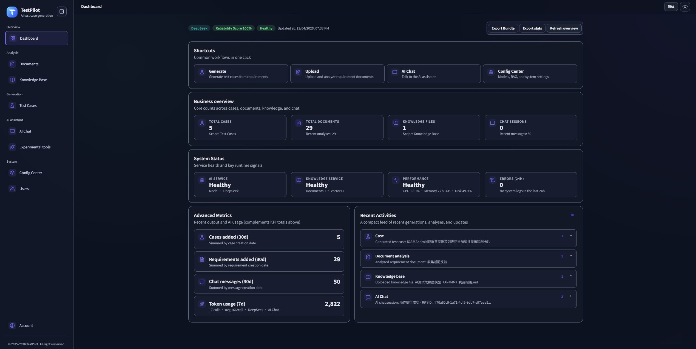
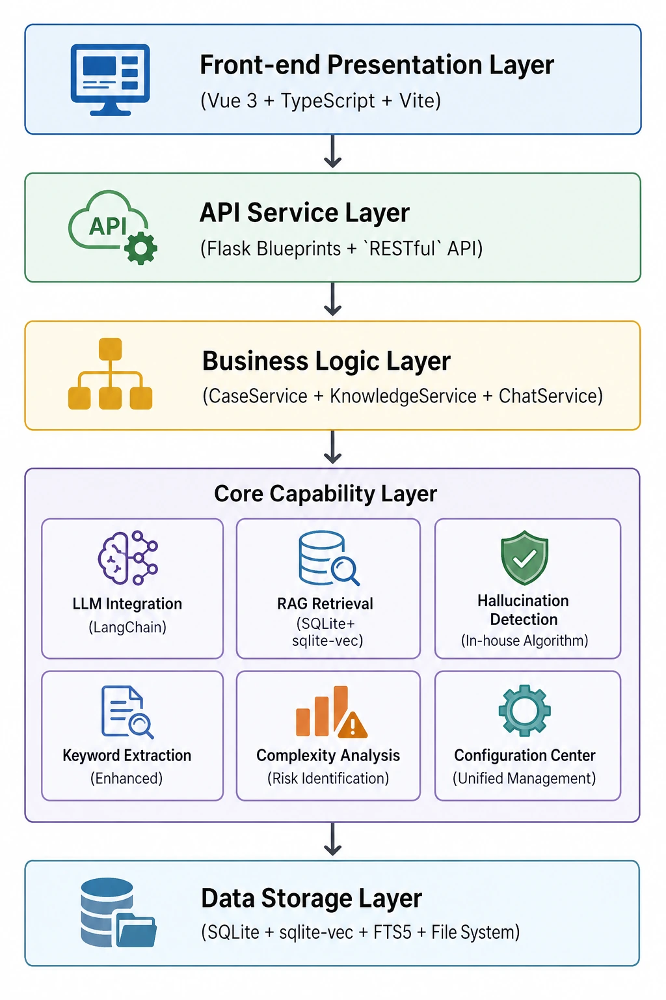
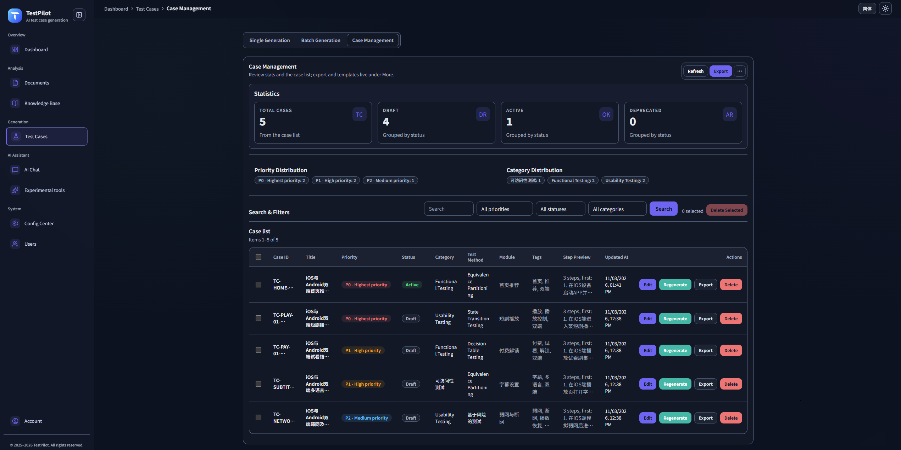
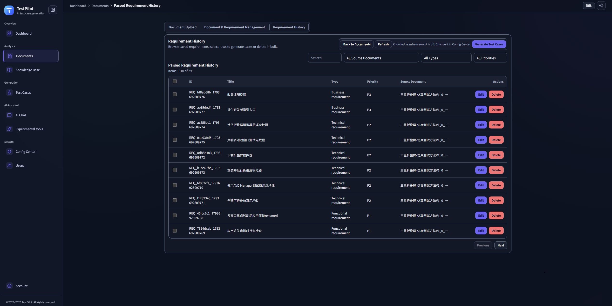
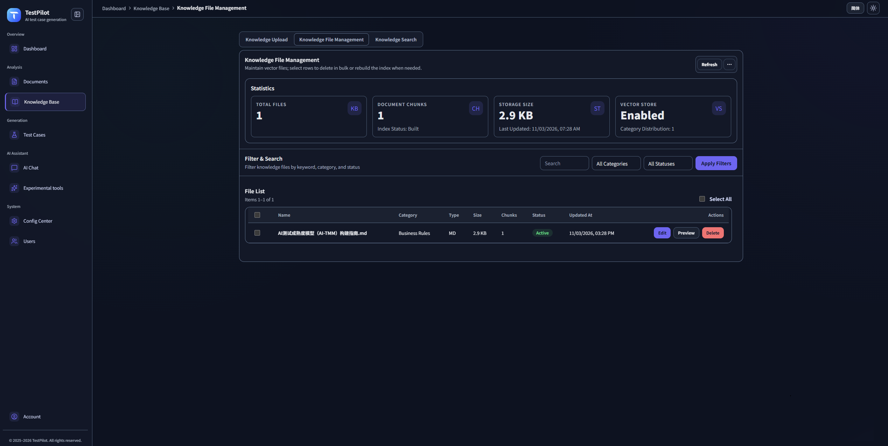
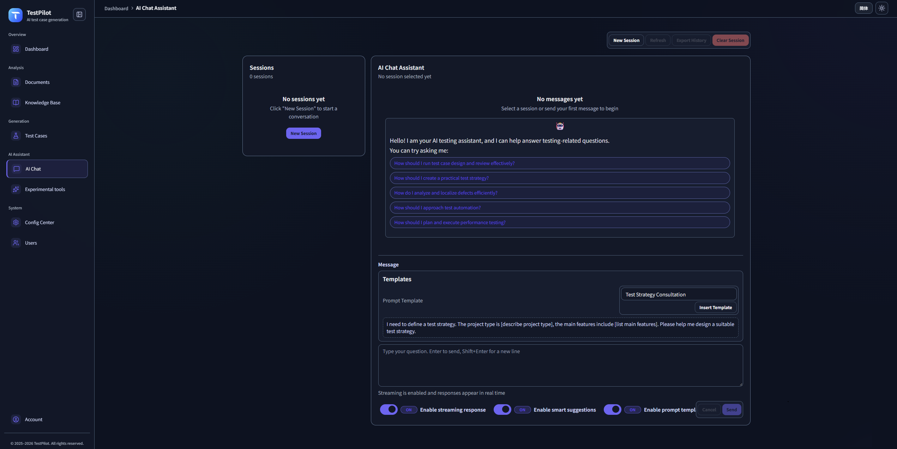
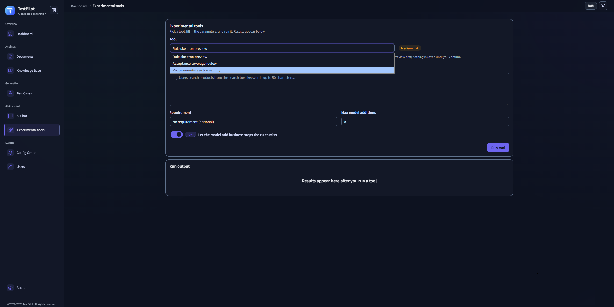
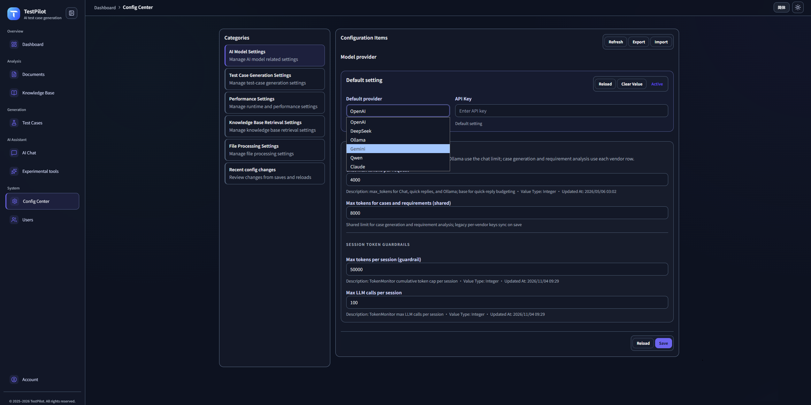

<div align="center">

# TestPilot - Intelligent Test Case Generation and Management Tool


**AI-powered intelligent test case generation and management platform**

[](https://python.org)
[](https://flask.palletsprojects.com)
[](https://vuejs.org)
[](LICENSE)

[中文](README.md) • [English](README_en.md)

[Features](#features) • [Architecture](#architecture--principles) • [Technology Stack](#technology-stack) • [Operations](docs/OPERATIONS.en.md) • [Configuration](docs/CONFIGURATION.en.md)

</div>



## Project Overview

TestPilot is an intelligent test case generation tool based on Large Language Models (LLMs). It can automatically analyze requirement documents and generate high-quality test cases. With an advanced hallucination detection system, it ensures the accuracy and reliability of AI-generated content, aiming to improve software testing efficiency and reduce manual test case authoring workload.

## Background

### Industry Background

In software testing, test case design is a key step to ensure software quality. As systems grow larger and iteration cycles become faster, traditional manual test case authoring faces unprecedented challenges:

- **Exploding workload**: Modern systems are complex with diverse scenarios; writing test cases manually is extremely time-consuming.
- **Higher quality expectations**: Users demand more reliable and thoroughly tested software.
- **Poor knowledge reuse**: Testing experience is scattered across projects and hard to reuse effectively.
- **Mature AI technology**: Rapid development of LLMs provides the foundation for automated test case generation.

### Project Goals

TestPilot aims to solve real testing pain points using AI, building an intelligent platform for test case generation and management:

1.**Improve efficiency**: Reduce test case generation time from hours to minutes.
2.**Ensure quality**: Use RAG and hallucination detection to keep results accurate and reliable.
3.**Accumulate knowledge**: Turn historical test experience and best practices into a searchable knowledge base.
4.**Reduce cost**: Cut repetitive work so test engineers can focus on higher-level design and analysis.

## Pain Points Addressed

### 1. Low efficiency of test case authoring

**Pain**:
- Manually writing test cases for a complex requirement can take hours or days.
- Testers need to repeatedly read requirements and understand business logic.
- Edge cases and negative scenarios are often missed.

**Solution**:
- Automatically generate base test cases in seconds using LLMs.
- Intelligent requirement analysis to extract test points and business rules.
- Automatic generation of negative and boundary test cases.

### 2. Unstable test case quality

**Pain**:
- Different engineers produce test cases with inconsistent quality.
- Lack of unified test case standards and conventions.
- Incomplete coverage and missing key test points.

**Solution**:
- RAG-enhanced generation based on historical test experience and knowledge base.
- Multi-strategy intelligent retrieval (semantic, keyword, hybrid, context-aware).
- Complexity and risk analysis to recommend proper test types and methods.
- Hallucination detection to ensure content correctness.

### 3. Hard-to-reuse testing experience

**Pain**:
- Testing experience is scattered across projects.
- Similar requirements require rewriting similar test cases.
- Historical test cases and best practices are not fully leveraged.

**Solution**:
- Build a vector knowledge base storing historical test cases, requirement docs, and standards.
- Intelligent retrieval that automatically finds relevant historical experience.
- RAG to inject historical knowledge into new test case generation.

### 4. Hallucinations in AI-generated content

**Pain**:
- LLMs may generate plausible but incorrect content.
- Lack of effective quality checks.
- Requires manual review and increases workload.

**Solution**:
- In-house multi-dimensional hallucination detection (pattern, logic, confidence).
- Automated handling strategies (warn, correct, regenerate, filter).
- Real-time quality checks to ensure reliability.

### 5. Heavy requirement analysis workload

**Pain**:
- Requirement documents come in various formats and are hard to parse.
- Test points and business rules must be manually extracted.
- Frequent requirement changes require repeated analysis.

**Solution**:
- Support multiple formats (TXT, DOC, PDF, Markdown, etc.).
- Intelligent keyword extraction with stop-word filtering and technical term recognition.
- Automatic extraction of requirement points, business rules, and constraints.
- Complexity evaluation and test workload estimation.

### 6. Ineffective knowledge base retrieval

**Pain**:
- Traditional keyword search cannot understand semantics.
- Irrelevant search results lead to poor knowledge reuse.
- Lacks context awareness.

**Solution**:
- Multi-strategy intelligent retrieval (semantic, keyword, hybrid, context-aware).
- Smart re-ranking and query expansion.
- Context-aware retrieval leveraging dialogue history.
- Performance monitoring and optimization.

## Architecture & Principles

### High-level Architecture

TestPilot adopts a layered architecture combined with modern techniques:



### Vector Store Architecture

**Current architecture**: SQLite + sqlite-vec + FTS5 (ChromaDB has been replaced)

- **Embedding**: FastEmbed (ONNX/CPU), no PyTorch required.
- **Vector store**: SQLite single-file DB + sqlite-vec extension.
- **Full-text index**: FTS5 virtual table for keyword recall.
- **Hybrid retrieval**: two-stage FTS5 keyword recall + sqlite-vec vector re-ranking.

**Benefits**:
- Single-file DB, easy to deploy and back up.
- No external services (unlike ChromaDB).
- Lightweight (FastEmbed ONNX, no GPU).
- Better performance than pure vector search at scale.

### 1. Intelligent Test Case Generation

#### 1.1 Requirement Analysis & Enrichment

```
Requirement Text
    ↓
Keyword Extraction (stop-word filtering + tech term recognition)
    ↓
Knowledge Retrieval (multi-strategy)
    ↓
Context Enrichment (historical cases + standards + rules)
    ↓
Complexity Analysis (risk + test type recommendation)
    ↓
LLM Generation (enhanced prompts + structured output)
    ↓
Hallucination Detection (multi-dimensional)
    ↓
Test Case Output
```

#### 1.2 RAG Flow

1.**Query understanding**: Analyze requirements and extract key test points.
2.**Knowledge retrieval**:
   - Semantic: vector similarity for related historical cases.
   - Keyword: match testing standards and docs.
   - Hybrid: combine semantic + keyword for better relevance.
   - Context-aware: leverage dialog history.
3.**Re-ranking**: Sort results by relevance and rules.
4.**Context building**: Assemble enriched context.
5.**Generation**: Inject context into prompts to improve quality.

### 2. Multi-strategy Retrieval System

#### 2.1 Strategies

- **Semantic retrieval**: vector similarity, understand intent.
- **Keyword retrieval**: precise keyword matching.
- **Hybrid retrieval**: FTS5 + sqlite-vec (two-stage).
- **Context-aware retrieval**: adjust strategy using dialog history.

#### 2.2 Hybrid Retrieval (FTS5 + sqlite-vec)

**Two stages**:

1. **Stage 1: FTS5 keyword recall (adaptive candidate count)**
   - Use FTS5 to quickly recall candidates.
   - Adaptive K: `fts_candidate_k = min(topK × factor, MAX_FTS_CANDIDATE_K)`.
   - Query complexity adjustment:
     - Simple (token ≤ 2): `factor *= 2`.
     - Complex (token ≥ 8): `factor = max(10, factor // 2)`.
     - Medium: base factor (default 40).
   - If FTS hits < topK, keep all hits.

1.**Stage 2: sqlite-vec re-ranking**
   - Compute cosine distance via `vec_distance_cosine`.
   - Sort by similarity and return topK.
   - P0-1 fix: if candidates ≥ 999, process in batches (avoid SQLite IN limit).
   - Adaptive strategy based on topK and query complexity.

**Config**:
- `ENABLE_HYBRID_RETRIEVAL=true`
- `FTS_CANDIDATE_FACTOR=40`
- `MAX_FTS_CANDIDATE_K=800`
- `FTS_CANDIDATE_K=200` (deprecated, kept for backward compatibility)

**Fallback behavior** (by design):
- sqlite-vec not available → fall back to full scan in Python.
- FTS5 not available → fall back to pure vector search.
- FTS5 no hits → fall back to pure vector search.
- All fallbacks log warnings (no silent failure).

### 3. Hallucination Detection

#### 3.1 Dimensions

1.**Pattern matching**: detect common hallucination phrases.
2.**Logical analysis**: find contradictions and inconsistencies.
3.**Confidence scoring**: compute quality confidence.

#### 3.2 Handling

Based on confidence thresholds:

- **Warn** (conf < 0.3): show warning only.
- **Autocorrect** (0.3 ≤ conf < 0.5): try automatic correction.
- **Regenerate** (0.5 ≤ conf < 0.7): call LLM again.
- **Manual review** (0.7 ≤ conf < 0.9): flag for human.
- **Filter** (conf ≥ 0.9): discard.

### 4. Enhanced Keyword Extraction

#### 4.1 Strategies

- **Config-based keywords**: platforms, apps, features, tech terms.
- **Direct extraction**: entities and noun phrases from text.
- **Stop-word filtering**.
- **Tech term recognition**: testing-domain terminology.

#### 4.2 Use Cases

- Requirement analysis: extract core concepts and test points.
- Knowledge retrieval: improve queries and relevance.
- Test generation: enrich prompts.

### 5. Config Center

#### 5.1 Management

- **Unified** web UI for all configs.
- **Categorized** by module (AI, RAG, performance, etc.).
- **Priority**: Config Center > .env > defaults.
- **Dynamic**: changes applied without restart.

#### 5.2 Security

- Sensitive info encrypted (API keys, etc.).
- Format and required-field validation.
- Audit logs for all config changes.

### 6. Data Flow

```
User Input (Requirements)
    ↓
Preprocessing (keywords + complexity)
    ↓
Knowledge Retrieval (multi-strategy + re-ranking)
    ↓
Context Enrichment (history + standards + rules)
    ↓
LLM Generation (enhanced prompts + structured output)
    ↓
Hallucination Detection (multi-dimensional + confidence)
    ↓
Automatic Handling (strategy based on confidence)
    ↓
Test Case Output (JSON + structured data)
    ↓
Storage (DB + vector store + file system)
```

### 7. Key Advantages

1.**Intelligent**: LLM + RAG for truly smart generation.
2.**High quality**: multidimensional hallucination detection.
3.**Extensible**: multiple AI providers with flexible configs.
4.**High performance**: optimized retrieval and caching.
5.**Usable**: modern UI with simple flows.

### Core Value

- **Intelligent generation** across rich testing scenarios.
- **Requirement analysis** with automated extraction of points and rules.
- **RAG-enhanced** knowledge reuse with multi-strategy retrieval.
- **Keyword extraction** with stop-word filtering and term recognition.
- **Hallucination detection** for safe and reliable AI content.
- **Config center** for visual, auditable configuration management.
- **Multi-model support**: OpenAI, Google Gemini, DeepSeek, Ollama, etc.
- **Modern UI**: responsive interface based on the `tp-*` design system.

## Project Structure
```text
TestPilot-vue/
├── app.py                          Flask app factory, blueprint registration, frontend asset serving
├── run.py                          Startup entry (backend + frontend dev flow)
├── config/
│   ├── settings.py                 Core runtime settings (models/RAG/retrieval/flags)
│   ├── filter_keywords.json        Keyword config
│   └── hallucination_config.json   Hallucination detection config
├── blueprints/                     API routes (auth, cases, chat, documents, knowledge, stats, config, export, experimental)
├── services/                       Business services (cases, chat, documents, knowledge, auth, config center, export)
├── models/                         SQLAlchemy models
├── utils/                          Utilities (model adapters, retrieval, quality, document processing, config)
├── experiments/                    Experimental action runtime (rule skeleton, orchestration, validation)
├── pilotAgent/                     Test-case generation agent
├── scripts/                        Init, check, and maintenance scripts
├── tests/                          Test suites
├── frontend/                       Vue 3 + TypeScript + Vite frontend
│   ├── src/
│   │   ├── api/                    API clients
│   │   ├── components/             Vue components (including shadcn-style primitives)
│   │   ├── composables/            Composables
│   │   ├── layouts/                Page layouts
│   │   ├── views/                  Page views
│   │   ├── router/                 Routing
│   │   ├── stores/                 Pinia stores
│   │   ├── i18n/                   i18n resources (zh-CN/en)
│   │   ├── lib/                    Page and domain UI classes, field-control, utils
│   │   ├── config/                 Frontend config such as navigation
│   │   ├── utils/                  Frontend helpers
│   │   └── styles/                 Tokens, Tailwind, chat-rich-content
│   ├── docs/UI-REDESIGN-PLAN.md    Frontend UI redesign plan
│   ├── docs/UI-MIGRATION.md        Frontend UI migration notes (Tailwind + shadcn-vue)
│   ├── public/                     Static assets
│   └── package.json                Frontend scripts/dependencies
├── uploads/                        Uploaded files (documents/knowledge)
├── vector_store/                   SQLite vector store directory
├── docs/                           Project docs
├── README.md                       Chinese README
└── README_en.md                    English README
```

## Features

### Test Case Generation

- **Intelligent generation** from requirement descriptions.
- **Batch processing** for multiple requirements.
- **Priority assignment** based on analysis.
- **Negative cases** and boundary scenarios.
- **Case optimization** using historical data.
- **Quality checks** (hallucination and logic issues).
- **Keyword extraction** with stop-word filtering and tech term detection.
- **RAG enhancement** via knowledge base retrieval.



### Requirement Analysis

- **Document parsing** for multiple formats (TXT, DOC, PDF, etc.).
- **Smart extraction** of requirement points and test points.
- **Enhanced keyword extraction** (concepts, terms, entities, phrases).
- **Business rule extraction** and constraint identification.
- **Complexity evaluation** and workload estimation.
- **Stop-word filtering** for cleaner keywords.



### Knowledge Base Management

- **File upload** for various knowledge sources.
- **Vectorized storage** using SQLite + sqlite-vec.
- **Intelligent retrieval** (semantic, keyword, hybrid, context-aware).
- **Enhanced keyword extraction** for retrieval and RAG.
- **Retrieval optimization** (re-ranking, query expansion, monitoring).
- **Category & tag management**.



### AI Testing Assistant

- **Domain-specific chat assistant**.
- **Streaming responses** for real-time UX.
- **Context memory** for multi-turn dialogues.
- **Templates** for common testing scenarios.
- **Content quality checks** on AI replies.



### Experimental tools

- **Rule skeleton**: deterministic cases from acceptance criteria, optional model fill-in, saved only after preview confirmation.
- **Coverage review**: compare linked cases against a requirement and list gaps.
- **Trace matrix**: requirements without cases, dangling requirement IDs, and unlinked cases.
- On by default. Set `ENABLE_EXPERIMENTAL_ACTIONS=false` to turn experimental tools off. Open them from the sidebar.



### Hallucination Detection

- **Multi-dimensional detection** of hallucinations.
- **Pattern recognition** for risky phrases.
- **Logical analysis** for contradictions.
- **Confidence scoring** for content quality.
- **Automatic handling** (warn, correct, regenerate, etc.).
- **Detailed reports** with improvement suggestions.

### Config Center

- **Unified configuration UI**.
- **Config priority**: Config Center > .env > defaults.
- **Audit logs** for all changes.
- **Validation rules** for safety (e.g., API key format).
- **Sensitive data protection**.
- **Dynamic effects** without restart.



### Data Management

- **Multi-format export** (Excel, CSV, JSON).
- **Statistics** and usage analytics.
- **Versioning** for test cases.
- **Batch operations** for case management.

## Technology Stack

### Backend

- **Framework**: Flask 3.1
- **DB**: SQLite (default, `testpilot.db`). The current requirements have no PostgreSQL or MySQL driver, so those are not wired up
- **ORM**: SQLAlchemy
- **Vector store**: SQLite + sqlite-vec + FTS5 (default and recommended)
- **AI integration**: LangChain
- **Smart retrieval**: multi-strategy retrieval system
- **Keyword extraction**: enhanced extractor
- **Hallucination detection**: in-house multidimensional system
- **Config management**: Config Center
- **Session management**: Flask-Session
- **How it runs**: development uses the Flask dev server. Production on Windows uses Waitress (pinned; selected by `run.py`). Linux and macOS use Gunicorn with an Eventlet worker (`eventlet` is pinned; install `gunicorn` separately). There is no WebSocket server

### Frontend

- **Framework**: Vue 3 + TypeScript + Vite
- **State & Routing**: Pinia + vue-router + vue-i18n
- **Styling**: Tailwind CSS 3 + shadcn-vue-style primitives (built on reka-ui) + `tp-*` design tokens
- **Icons**: @lucide/vue

### AI Models

- **OpenAI**: gpt-5 (default), gpt-4o  
- **Google Gemini**: gemini-3.8-flash  
- **DeepSeek**: deepseek-flash (V4.1-Flash)  
- **Qwen**: qwen-flash, qwen-plus, qwen-max
- **Anthropic (Claude)**: claude-sonnet-5-5 (default), claude-opus-5-5, claude-haiku-5-5, claude-fable-5-1. Uses the Messages API, not an OpenAI-compatible base URL. See [Configuration](docs/CONFIGURATION.en.md)
- **Ollama**: local models
- **Custom**: other OpenAI-compatible endpoints. Claude is not in this group  


## Documentation

- [Operations](docs/OPERATIONS.en.md): install, first-time setup, sign-in, daily use, deployment, tests, and troubleshooting
- [Configuration](docs/CONFIGURATION.en.md): environment variables, vector store, and model setup, including Anthropic / Claude
- [Authentication and RBAC](docs/AUTH-RBAC.en.md)
- [Config Center](docs/CONFIG-CENTER.en.md)

## License

This project is released under the [MIT License](LICENSE).

## Acknowledgements

- [Flask](https://flask.palletsprojects.com/)
- [Vue](https://vuejs.org/)
- [LangChain](https://langchain.com/)
- [sqlite-vec](https://github.com/asg017/sqlite-vec) (SQLite vector search extension)
- [SQLAlchemy](https://www.sqlalchemy.org/)
## Contact

- **Project**: https://github.com/zhoujun94511/TestPilot-vue
- **Issues**: https://github.com/zhoujun94511/TestPilot-vue/issues

---

<div align="center">

**If this project helps you, please give it a ⭐️!**

Made with ❤️ by TestPilot

</div>

