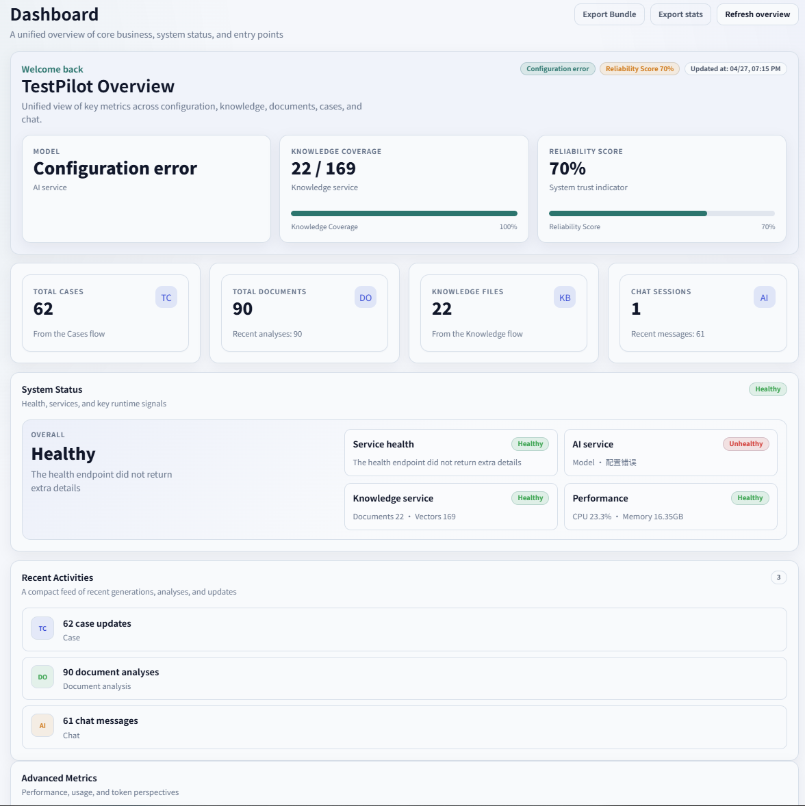
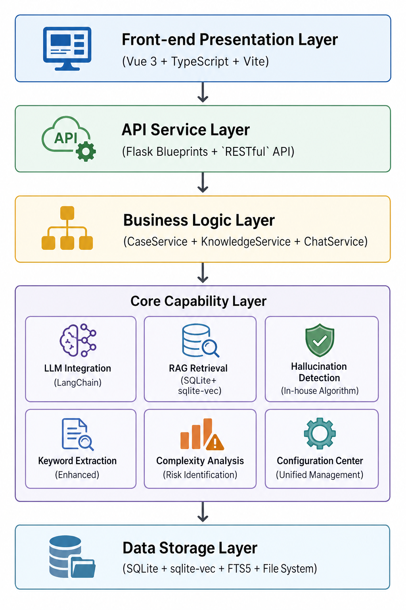
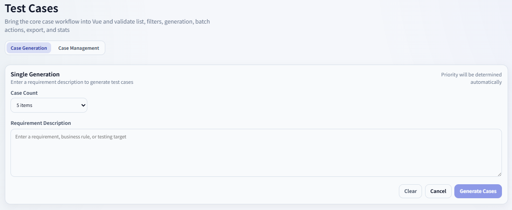
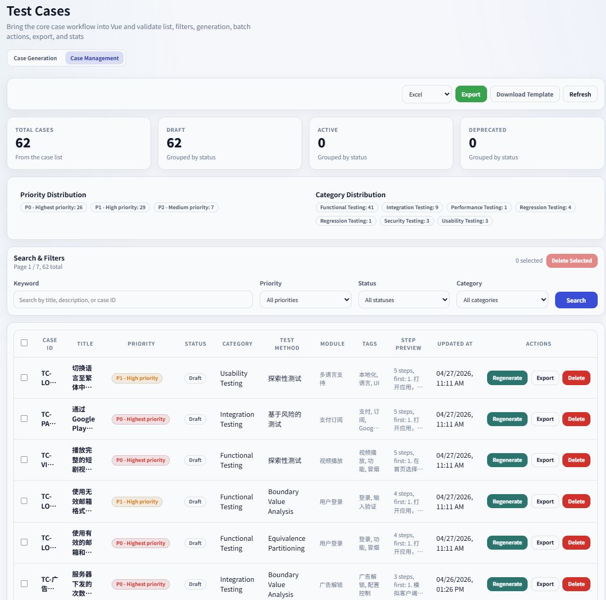
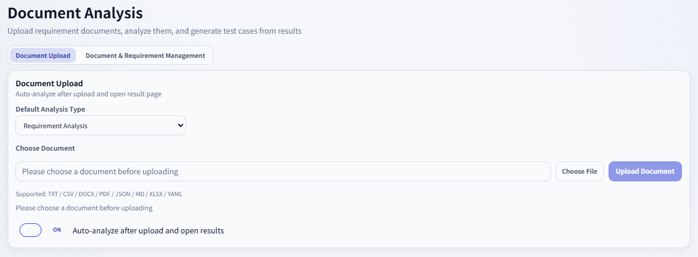
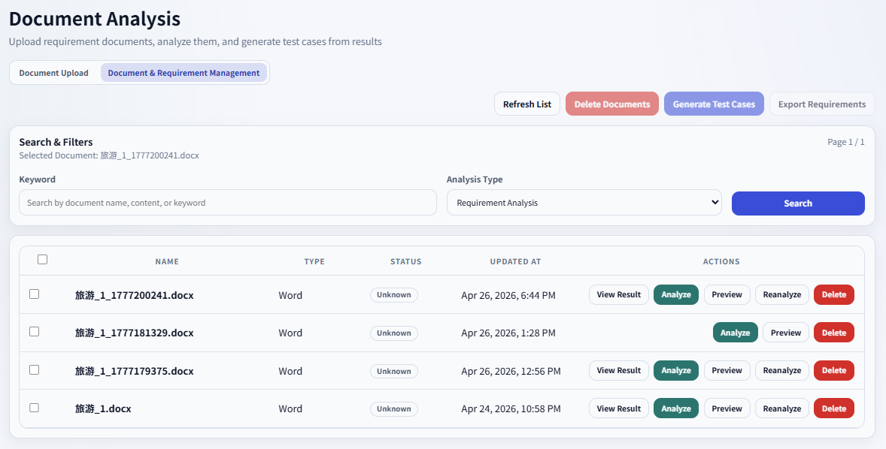
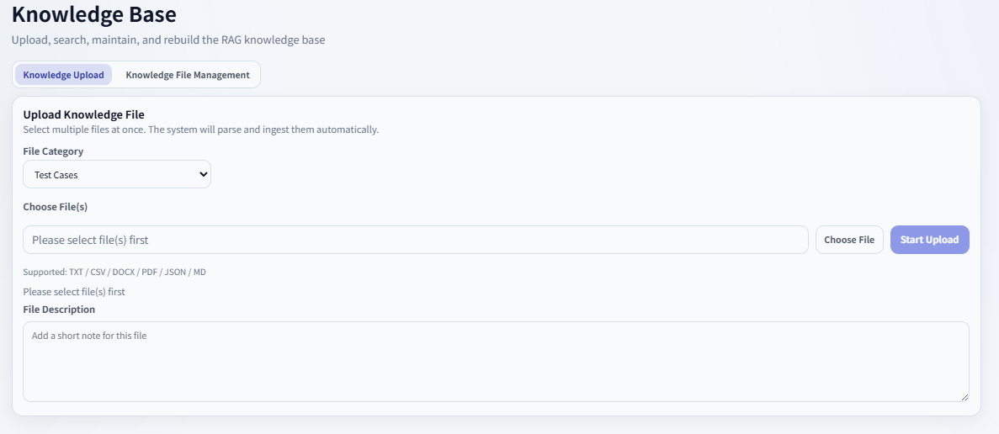
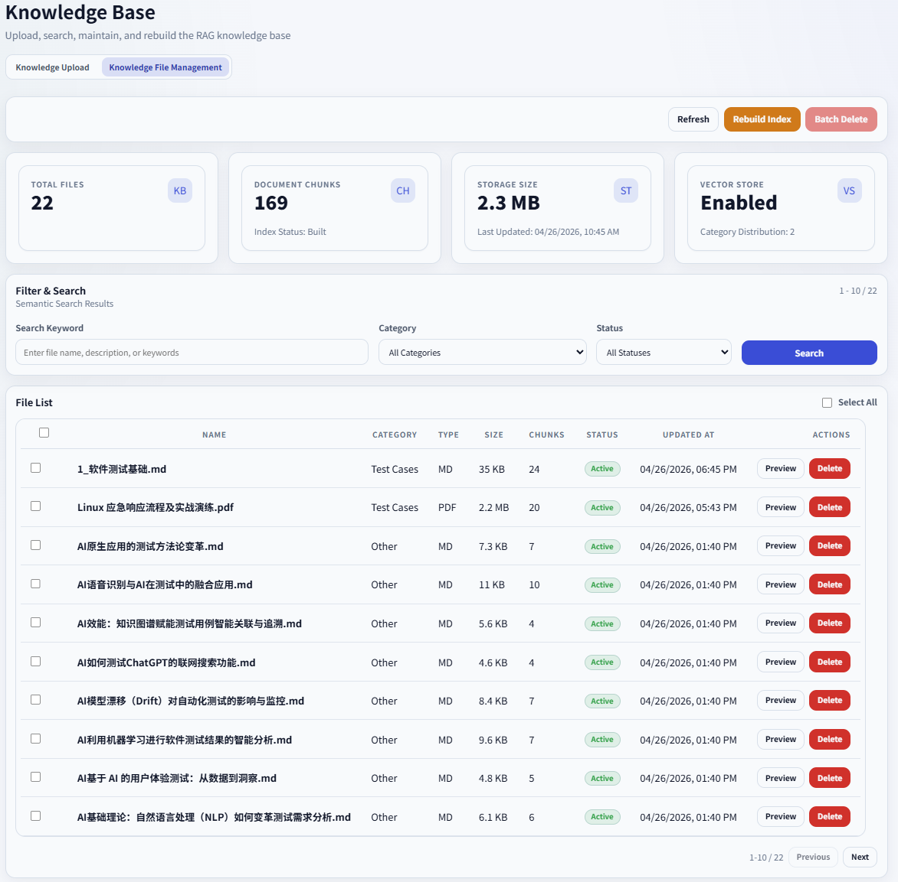
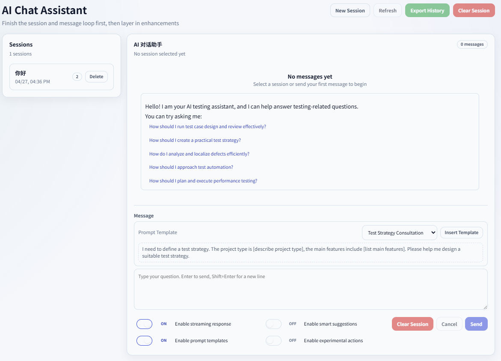

# TestPilot - Intelligent Test Case Generation Tool

<div align="center">


**AI-powered intelligent test case generation and management platform**

[](https://python.org)
[](https://flask.palletsprojects.com)
[](https://vuejs.org)
[](LICENSE)

[中文](README.md) • [English](README_en.md)

[Features](#features) • [Quick Start](#quick-start) • [Deployment Guide](#deployment-guide) • [API Docs](#api-documentation-high-level) • [Contributing](#contributing)

</div>



## Project Overview

TestPilot is an intelligent test case generation tool based on Large Language Models (LLMs). It can automatically analyze requirement documents and generate high-quality test cases. With an advanced hallucination detection system, it ensures the accuracy and reliability of AI-generated content, aiming to improve software testing efficiency and reduce manual test case authoring workload.

## Background

### Industry Background

In software testing, test case design is a key step to ensure software quality. As systems grow larger and iteration cycles become faster, traditional manual test case authoring faces unprecedented challenges:

- **Exploding workload**: Modern systems are complex with diverse scenarios; writing test cases manually is extremely time-consuming.
- **Higher quality expectations**: Users demand more reliable and thoroughly tested software.
- **Poor knowledge reuse**: Testing experience is scattered across projects and hard to reuse effectively.
- **Mature AI technology**: Rapid development of LLMs provides the foundation for automated test case generation.

### Project Goals

TestPilot aims to solve real testing pain points using AI, building an intelligent platform for test case generation and management:

1.**Improve efficiency**: Reduce test case generation time from hours to minutes.
2.**Ensure quality**: Use RAG and hallucination detection to keep results accurate and reliable.
3.**Accumulate knowledge**: Turn historical test experience and best practices into a searchable knowledge base.
4.**Reduce cost**: Cut repetitive work so test engineers can focus on higher-level design and analysis.

## Pain Points Addressed

### 1. Low efficiency of test case authoring

**Pain**:
- Manually writing test cases for a complex requirement can take hours or days.
- Testers need to repeatedly read requirements and understand business logic.
- Edge cases and negative scenarios are often missed.

**Solution**:
- Automatically generate base test cases in seconds using LLMs.
- Intelligent requirement analysis to extract test points and business rules.
- Automatic generation of negative and boundary test cases.

### 2. Unstable test case quality

**Pain**:
- Different engineers produce test cases with inconsistent quality.
- Lack of unified test case standards and conventions.
- Incomplete coverage and missing key test points.

**Solution**:
- RAG-enhanced generation based on historical test experience and knowledge base.
- Multi-strategy intelligent retrieval (semantic, keyword, hybrid, context-aware).
- Complexity and risk analysis to recommend proper test types and methods.
- Hallucination detection to ensure content correctness.

### 3. Hard-to-reuse testing experience

**Pain**:
- Testing experience is scattered across projects.
- Similar requirements require rewriting similar test cases.
- Historical test cases and best practices are not fully leveraged.

**Solution**:
- Build a vector knowledge base storing historical test cases, requirement docs, and standards.
- Intelligent retrieval that automatically finds relevant historical experience.
- RAG to inject historical knowledge into new test case generation.

### 4. Hallucinations in AI-generated content

**Pain**:
- LLMs may generate plausible but incorrect content.
- Lack of effective quality checks.
- Requires manual review and increases workload.

**Solution**:
- In-house multi-dimensional hallucination detection (pattern, logic, confidence).
- Automated handling strategies (warn, correct, regenerate, filter).
- Real-time quality checks to ensure reliability.

### 5. Heavy requirement analysis workload

**Pain**:
- Requirement documents come in various formats and are hard to parse.
- Test points and business rules must be manually extracted.
- Frequent requirement changes require repeated analysis.

**Solution**:
- Support multiple formats (TXT, DOC, PDF, Markdown, etc.).
- Intelligent keyword extraction with stop-word filtering and technical term recognition.
- Automatic extraction of requirement points, business rules, and constraints.
- Complexity evaluation and test workload estimation.

### 6. Ineffective knowledge base retrieval

**Pain**:
- Traditional keyword search cannot understand semantics.
- Irrelevant search results lead to poor knowledge reuse.
- Lacks context awareness.

**Solution**:
- Multi-strategy intelligent retrieval (semantic, keyword, hybrid, context-aware).
- Smart re-ranking and query expansion.
- Context-aware retrieval leveraging dialogue history.
- Performance monitoring and optimization.

## Architecture & Principles

### High-level Architecture

TestPilot adopts a layered architecture combined with modern techniques:

```
┌─────────────────────────────────────────────────────────┐
│                    Presentation Layer                   │
│  (Vue 3 + TypeScript + Vite + tp-* Design System)      │
└─────────────────────────────────────────────────────────┘
                          ↓
┌─────────────────────────────────────────────────────────┐
│                    API Service Layer                    │
│  (Flask Blueprints + `RESTful` API)                     │
└─────────────────────────────────────────────────────────┘
                          ↓
┌─────────────────────────────────────────────────────────┐
│                    Business Logic Layer                 │
│  (CaseService + KnowledgeService + ChatService)        │
└─────────────────────────────────────────────────────────┘
                          ↓
┌─────────────────────────────────────────────────────────┐
│                    Core Capability Layer                │
│  ┌──────────────┐  ┌──────────────┐  ┌──────────────┐ │
│  │ LLM          │  │ RAG          │  │ Hallucination│ │
│  │ Integration  │  │ Retrieval    │  │ Detection    │ │
│  │ (LangChain)  │  │ (SQLite +    │  │ (Custom)     │ │
│  │              │  │  sqlite-vec) │  │              │ │
│  └──────────────┘  └──────────────┘  └──────────────┘ │
│  ┌──────────────┐  ┌──────────────┐  ┌──────────────┐ │
│  │ Keyword      │  │ Complexity   │  │ Config       │ │
│  │ Extraction   │  │ Analysis     │  │ Center       │ │
│  │ (Enhanced)   │  │ (Risk)       │  │ (Unified)    │ │
│  └──────────────┘  └──────────────┘  └──────────────┘ │
└─────────────────────────────────────────────────────────┘
                          ↓
┌─────────────────────────────────────────────────────────┐
│                    Data Storage Layer                   │
│  (SQLite + sqlite-vec + FTS5 + File System)             │
│                  FastEmbed (ONNX/CPU)                   │
└─────────────────────────────────────────────────────────┘
```



### Vector Store Architecture

**Current architecture**: SQLite + sqlite-vec + FTS5 (ChromaDB has been replaced)

- **Embedding**: FastEmbed (ONNX/CPU), no PyTorch required.
- **Vector store**: SQLite single-file DB + sqlite-vec extension.
- **Full-text index**: FTS5 virtual table for keyword recall.
- **Hybrid retrieval**: two-stage FTS5 keyword recall + sqlite-vec vector re-ranking.

**Benefits**:
- Single-file DB, easy to deploy and back up.
- No external services (unlike ChromaDB).
- Lightweight (FastEmbed ONNX, no GPU).
- Better performance than pure vector search at scale.

### 1. Intelligent Test Case Generation

#### 1.1 Requirement Analysis & Enrichment

```
Requirement Text
    ↓
Keyword Extraction (stop-word filtering + tech term recognition)
    ↓
Knowledge Retrieval (multi-strategy)
    ↓
Context Enrichment (historical cases + standards + rules)
    ↓
Complexity Analysis (risk + test type recommendation)
    ↓
LLM Generation (enhanced prompts + structured output)
    ↓
Hallucination Detection (multi-dimensional)
    ↓
Test Case Output
```

#### 1.2 RAG Flow

1.**Query understanding**: Analyze requirements and extract key test points.
2.**Knowledge retrieval**:
   - Semantic: vector similarity for related historical cases.
   - Keyword: match testing standards and docs.
   - Hybrid: combine semantic + keyword for better relevance.
   - Context-aware: leverage dialog history.
3.**Re-ranking**: Sort results by relevance and rules.
4.**Context building**: Assemble enriched context.
5.**Generation**: Inject context into prompts to improve quality.

### 2. Multi-strategy Retrieval System

#### 2.1 Strategies

- **Semantic retrieval**: vector similarity, understand intent.
- **Keyword retrieval**: precise keyword matching.
- **Hybrid retrieval**: FTS5 + sqlite-vec (two-stage).
- **Context-aware retrieval**: adjust strategy using dialog history.

#### 2.2 Hybrid Retrieval (FTS5 + sqlite-vec)

**Two stages**:

1. **Stage 1: FTS5 keyword recall (adaptive candidate count)**
   - Use FTS5 to quickly recall candidates.
   - Adaptive K: `fts_candidate_k = min(topK × factor, MAX_FTS_CANDIDATE_K)`.
   - Query complexity adjustment:
     - Simple (token ≤ 2): `factor *= 2`.
     - Complex (token ≥ 8): `factor = max(10, factor // 2)`.
     - Medium: base factor (default 40).
   - If FTS hits < topK, keep all hits.

1.**Stage 2: sqlite-vec re-ranking**
   - Compute cosine distance via `vec_distance_cosine`.
   - Sort by similarity and return topK.
   - P0-1 fix: if candidates ≥ 999, process in batches (avoid SQLite IN limit).
   - Adaptive strategy based on topK and query complexity.

**Config**:
- `ENABLE_HYBRID_RETRIEVAL=true`
- `FTS_CANDIDATE_FACTOR=40`
- `MAX_FTS_CANDIDATE_K=800`
- `FTS_CANDIDATE_K=200` (deprecated, kept for backward compatibility)

**Fallback behavior** (by design):
- sqlite-vec not available → fall back to full scan in Python.
- FTS5 not available → fall back to pure vector search.
- FTS5 no hits → fall back to pure vector search.
- All fallbacks log warnings (no silent failure).

### 3. Hallucination Detection

#### 3.1 Dimensions

1.**Pattern matching**: detect common hallucination phrases.
2.**Logical analysis**: find contradictions and inconsistencies.
3.**Confidence scoring**: compute quality confidence.

#### 3.2 Handling

Based on confidence thresholds:

- **Warn** (conf < 0.3): show warning only.
- **Autocorrect** (0.3 ≤ conf < 0.5): try automatic correction.
- **Regenerate** (0.5 ≤ conf < 0.7): call LLM again.
- **Manual review** (0.7 ≤ conf < 0.9): flag for human.
- **Filter** (conf ≥ 0.9): discard.

### 4. Enhanced Keyword Extraction

#### 4.1 Strategies

- **Config-based keywords**: platforms, apps, features, tech terms.
- **Direct extraction**: entities and noun phrases from text.
- **Stop-word filtering**.
- **Tech term recognition**: testing-domain terminology.

#### 4.2 Use Cases

- Requirement analysis: extract core concepts and test points.
- Knowledge retrieval: improve queries and relevance.
- Test generation: enrich prompts.

### 5. Config Center

#### 5.1 Management

- **Unified** web UI for all configs.
- **Categorized** by module (AI, RAG, performance, etc.).
- **Priority**: Config Center > .env > defaults.
- **Dynamic**: changes applied without restart.

#### 5.2 Security

- Sensitive info encrypted (API keys, etc.).
- Format and required-field validation.
- Audit logs for all config changes.

### 6. Data Flow

```
User Input (Requirements)
    ↓
Preprocessing (keywords + complexity)
    ↓
Knowledge Retrieval (multi-strategy + re-ranking)
    ↓
Context Enrichment (history + standards + rules)
    ↓
LLM Generation (enhanced prompts + structured output)
    ↓
Hallucination Detection (multi-dimensional + confidence)
    ↓
Automatic Handling (strategy based on confidence)
    ↓
Test Case Output (JSON + structured data)
    ↓
Storage (DB + vector store + file system)
```

### 7. Key Advantages

1.**Intelligent**: LLM + RAG for truly smart generation.
2.**High quality**: multidimensional hallucination detection.
3.**Extensible**: multiple AI providers with flexible configs.
4.**High performance**: optimized retrieval and caching.
5.**Usable**: modern UI with simple flows.

### Core Value

- **Intelligent generation** across rich testing scenarios.
- **Requirement analysis** with automated extraction of points and rules.
- **RAG-enhanced** knowledge reuse with multi-strategy retrieval.
- **Keyword extraction** with stop-word filtering and term recognition.
- **Hallucination detection** for safe and reliable AI content.
- **Config center** for visual, auditable configuration management.
- **Multi-model support**: OpenAI, Google Gemini, DeepSeek, Ollama, etc.
- **Modern UI**: responsive interface based on the `tp-*` design system.

## Project Structure
```text
TestPilot/
├── Application Core
│   ├── app.py                    Flask application entry point
│   ├── run.py                    Startup entry point
│   ├── build.bat                 Windows build script
│   ├── build.spec                Packaging configuration
│   └── config/
│       ├── settings.py           Central configuration class
│       ├── filter_keywords.json  Keyword filtering config
│       ├── hallucination_config.json  Hallucination detection config
│       └── knowledge_base.json   Knowledge base config
│
├── Data Layer
│   ├── models/
│   │   ├── models.py             Core business models
│   │   └── config_models.py      Config center models
│   └── services/
│       ├── case_service.py       Test case generation service
│       ├── chat_service.py       AI chat service
│       ├── knowledge_service.py  Knowledge base management service
│       ├── document_service.py   Document analysis service
│       ├── export_service.py     Data export service
│       ├── stats_service.py      Statistics service
│       ├── config_service.py     Configuration service
│       └── config_center_service.py  Config center service
│
├── API Layer
│   └── blueprints/
│       ├── cases.py              Test case APIs
│       ├── chat.py               AI chat APIs
│       ├── knowledge.py          Knowledge base APIs
│       ├── documents.py          Requirement document APIs
│       ├── export.py             Data export APIs
│       ├── stats.py              Statistics APIs
│       └── config_center.py      Config center APIs
│
├── Frontend
│   ├── templates/
│   │   ├── base.html             Base template
│   │   ├── index.html            Home page template
│   │   └── components/
│   │       ├── cases_page.html   Test case page
│   │       ├── chat_page.html    AI chat page
│   │       ├── knowledge_page.html  Knowledge base page
│   │       ├── documents_page.html  Requirement analysis page
│   │       └── config_center.html   Config center page
│   ├── static/css/
│   │   ├── base.css              Base styles
│   │   ├── style.css             Main styles
│   │   ├── components.css        Component styles
│   │   ├── pages.css             Page styles
│   │   └── modules/              Module styles
│   └── static/js/
│       ├── main.js               Main entry
│       ├── api.js                API wrapper
│       ├── base.js               Base utilities
│       ├── cases.js              Test case features
│       ├── chat.js               AI chat features
│       ├── knowledge.js          Knowledge base features
│       ├── documents.js          Requirement analysis features
│       ├── config_center.js      Config center features
│       └── components/
│           ├── dashboard.js       Dashboard component
│           ├── modal.js           Modal component
│           ├── form.js            Form component
│           ├── pagination.js      Pagination component
│           ├── toast.js           Toast component
│           └── config_status_indicator.js  Config status indicator
│
├── Utilities
│   └── utils/
│       ├── utils_core/
│       │   ├── logger.py          Logging
│       │   ├── path_helper.py     Path helpers
│       │   ├── common_utils.py    Common utilities
│       │   ├── error_handler.py   Error handling
│       │   ├── json_utils.py      JSON utilities
│       │   ├── platform_utils.py  Platform adapters
│       │   └── remote_model_checker.py  Remote model checker
│       ├── utils_ai_models/
│       │   ├── get_llm.py         LLM provider entry
│       │   ├── embeddings.py      Embedding models
│       │   ├── embedding_manager.py  Embedding manager
│       │   └── embedding_monitor.py  Embedding monitor
│       ├── utils_ai_quality/
│       │   ├── hallucination_detector.py  Hallucination detector
│       │   ├── hallucination_handler.py   Hallucination handler
│       │   └── hallucination_reporter.py  Hallucination reporter
│       ├── utils_intelligent_retrieval/
│       │   ├── smart_retrieval_strategy.py  Multi-strategy retrieval
│       │   ├── requirement_keyword_extractor.py  Keyword extractor
│       │   └── rag_keyword_config.py       RAG keyword config
│       ├── utils_document_processing/
│       │   ├── parser.py           Document parser
│       │   ├── document_preprocessor.py  Document preprocessor
│       │   ├── smart_document_chunking.py  Smart chunking
│       │   └── file_preview.py     File preview
│       ├── utils_business_logic/
│       │   ├── case_id_generator.py  Case ID generator
│       │   ├── complexity_scorer.py   Complexity scorer
│       │   ├── requirements_analyze.py  Requirement analyzer
│       │   └── function_cases.py     Function case generation
│       ├── utils_config_management/
│       │   ├── smart_config_manager.py  Smart config manager
│       │   └── optimization_config.py   Optimization config
│       ├── utils_performance_monitoring/
│       │   ├── performance_monitor.py  Performance monitor
│       │   ├── token_monitor.py       Token monitor
│       │   └── cache_manager.py       Cache manager
│       └── utils_batch_processing/
│           ├── batch_processor.py    Batch processor
│           └── streaming_processor.py  Streaming processor
│
├── Scripts
│   ├── scripts/
│   │   ├── init_db.py              Database init script
│   │   ├── init_vectordb.py        Vector DB init script
│   │   ├── init_config_center.py   Config center init script
│   │   ├── batch_import_knowledge.py  Batch knowledge import
│   │   ├── check_knowledge_base.py    Knowledge base check
│   │   ├── check_system.py            System health check
│   │   ├── check_vector_db_garbled_text.py  Vector DB garbled text check
│   │   ├── clear_and_rebuild_knowledge.py   Clear and rebuild knowledge
│   │   ├── query_config_center.py     Config center query tool
│   │   └── atest_cross_platform.py    Cross-platform test script
│   └── install.py                 Installation script
│
├── Docs
│   ├── README.md                  Chinese main doc
│   ├── README_en.md               This file
│   └── docs/
│       └── introduce.md           Project introduction
│
└── Data
    ├── testpilot.db               SQLite database
    ├── vector_store/              Vector database directory
    ├── uploads/                   Uploaded files
    │   ├── documents/             Requirement documents
    │   └── knowledge/             Knowledge base files
    ├── sessions/                  Flask session storage
    └── logs/                      Log directory
```

## Features

### Test Case Generation

- **Intelligent generation** from requirement descriptions.
- **Batch processing** for multiple requirements.
- **Priority assignment** based on analysis.
- **Negative cases** and boundary scenarios.
- **Case optimization** using historical data.
- **Quality checks** (hallucination and logic issues).
- **Keyword extraction** with stop-word filtering and tech term detection.
- **RAG enhancement** via knowledge base retrieval.




### Requirement Analysis

- **Document parsing** for multiple formats (TXT, DOC, PDF, etc.).
- **Smart extraction** of requirement points and test points.
- **Enhanced keyword extraction** (concepts, terms, entities, phrases).
- **Business rule extraction** and constraint identification.
- **Complexity evaluation** and workload estimation.
- **Stop-word filtering** for cleaner keywords.




### Knowledge Base Management

- **File upload** for various knowledge sources.
- **Vectorized storage** using SQLite + sqlite-vec.
- **Intelligent retrieval** (semantic, keyword, hybrid, context-aware).
- **Enhanced keyword extraction** for retrieval and RAG.
- **Retrieval optimization** (re-ranking, query expansion, monitoring).
- **Category & tag management**.




### AI Testing Assistant

- **Domain-specific chat assistant**.
- **Streaming responses** for real-time UX.
- **Context memory** for multi-turn dialogues.
- **Templates** for common testing scenarios.
- **Content quality checks** on AI replies.



### Hallucination Detection

- **Multi-dimensional detection** of hallucinations.
- **Pattern recognition** for risky phrases.
- **Logical analysis** for contradictions.
- **Confidence scoring** for content quality.
- **Automatic handling** (warn, correct, regenerate, etc.).
- **Detailed reports** with improvement suggestions.

### Config Center

- **Unified configuration UI**.
- **Config priority**: Config Center > .env > defaults.
- **Audit logs** for all changes.
- **Validation rules** for safety (e.g., API key format).
- **Sensitive data protection**.
- **Dynamic effects** without restart.

### Data Management

- **Multi-format export** (Excel, CSV, JSON).
- **Statistics** and usage analytics.
- **Versioning** for test cases.
- **Batch operations** for case management.

## 🏗️ Technology Stack

### Backend

- **Framework**: Flask 3.0+
- **DB**: `SQLite` / `PostgreSQL` / `MySQL`
- **ORM**: SQLAlchemy
- **Vector store**: SQLite + sqlite-vec + FTS5 (ChromaDB path retained only for rollback)
- **AI integration**: LangChain
- **Smart retrieval**: multi-strategy retrieval system
- **Keyword extraction**: enhanced extractor
- **Hallucination detection**: in-house multidimensional system
- **Config management**: Config Center
- **Session management**: Flask-Session
- **Async/WebSocket**: Eventlet

### Frontend

- **UI System**: `tp-*` design system + Vue componentization
- **JS**: ES6+ modules
- **Icons**: Font Awesome 6.5
- **Charts**: Chart.js
- **Templates**: Jinja2

### AI Models

- **OpenAI**: GPT-5 (default), GPT-3.5, etc.  
- **Google Gemini**: Gemini 2.0 Flash, Gemini Pro  
- **DeepSeek**: DeepSeek-Chat  
- **Qwen**: qwen-flash, qwen-plus, qwen-max  
- **Ollama**: local models  
- **Custom**: any OpenAI-compatible provider  

## Quick Start

### Requirements

- Python 3.10+
- Node.js 16+ (optional, for frontend dev)
- 4GB+ RAM
- 2GB+ disk
- **Important**: PyTorch is removed; we use FastEmbed (ONNX/CPU), no GPU needed.

> **Note for GitHub**: `models/fastembed/` is a FastEmbed/HuggingFace model cache directory and can be large, so it should be ignored by `.gitignore` and not committed.  
> - **Online**: if the cache is missing, the embedding model will be downloaded automatically on first use.  
> - **Offline / packaged**: run `python scripts/preload_fastembed_models.py` on an online machine first and set `FASTEMBED_CACHE_DIR` if needed.

### Installation

1. **Clone**

```bash
git clone https://github.com/zhoujun94511/TestPilot-vue.git
cd TestPilot-vue
```

1. **Virtualenv**

```bash
python -m venv venv
# Windows
venv\Scripts\activate
# Linux/Mac
source venv/bin/activate
```

1. **Install deps**

```bash
pip install -r requirements.txt
```

1. **Preload embedding models (required for offline)**

```bash
# Default model (baai/bge-small-en-v1.5, dim=384)
python scripts/preload_fastembed_models.py

# Or specify model
python scripts/preload_fastembed_models.py --model baai/bge-base-en-v1.5

# Custom cache dir (optional)
export FASTEMBED_CACHE_DIR=/path/to/cache
python scripts/preload_fastembed_models.py
```

> For fully offline deployment, preload the model on an online machine, copy `~/.cache/fastembed` (or your custom cache) to the target, and set `FASTEMBED_CACHE_DIR`.

1. **Configure environment**

```bash
cp .env.example .env
# Edit .env and fill in required values
```

**Key vector-store related config** (current default is SQLite + sqlite-vec; ChromaDB is deprecated and kept only for rollback):

```bash
# Vector backend (default sqlite; historically sqlite/chroma, now sqlite is recommended)
VECTOR_BACKEND=sqlite

# Embedding
EMBEDDING_MODEL_NAME=baai/bge-small-en-v1.5
EMBEDDING_DIM=384  # must match actual model; cannot change without rebuilding DB

# SQLite vector store
SQLITE_VECTOR_DB_PATH=  # default: vector_store/vector_store.db
SQLITE_VEC_EXTENSION_PATH=  # optional sqlite-vec extension path

# Hybrid retrieval
ENABLE_HYBRID_RETRIEVAL=true
FTS_CANDIDATE_K=200  # legacy; still supported for compatibility
```

1. **Init relational DB**

```bash
python scripts/init_db.py
```

1. **Init vector DB (SQLite)**

```bash
python scripts/init_vectordb.py --init-vector-db
```

1. **Init Config Center (optional)**

```bash
python scripts/init_config_center.py
```

1. **Run app**

```bash
python run.py
```

1. **Open UI**

Visit `http://localhost:5000` in your browser.

## Configuration

### Config Management

TestPilot supports:

1.**Environment variables** (`.env`)
2.**Web-based Config Center**

See the Chinese `README.md` or `.env.example` for full details; key vector-related items are summarized above.  

### AI Model Config Examples

```bash
# OpenAI
DEFAULT_COMPANY=OPENAI
OPENAI_API_KEY=sk-your-openai-key
OPENAI_MODEL=gpt-5

# Google Gemini
DEFAULT_COMPANY=GEMINI
GEMINI_API_KEY=your-gemini-api-key
GEMINI_MODEL=gemini-2.0-flash

# DeepSeek
DEFAULT_COMPANY=DEEPSEEK
DEEPSEEK_API_KEY=your-deepseek-key
DEEPSEEK_MODEL=deepseek-chat

# Qwen
DEFAULT_COMPANY=QWEN
QWEN_API_KEY=your-qwen-api-key
QWEN_BASE_URL=https://dashscope.aliyuncs.com/compatible-mode/v1
QWEN_MODEL=qwen-flash
QWEN_TEMPERATURE=0.7
TR_QWEN_MAX_TOKENS=8000
QWEN_TIMEOUT=60

# Ollama (local)
DEFAULT_COMPANY=OLLAMA
OLLAMA_BASE_URL=http://localhost:11434
OLLAMA_MODEL=llama2
```

## Usage Guide (Overview)

- **Test Case Generation**: single/batch requirements, RAG, negative cases, optimization, hallucination detection.
- **Requirement Analysis**: file upload or text input, extract test points and rules.
- **Knowledge Base**: upload docs, smart retrieval, RAG integration.
- **AI Assistant**: testing Q&A, templates, context-aware chat.
- **Hallucination Detection**: automatic checks, strategies, and thresholds.
- **Config Center**: manage configs, priorities, audit logs, and sensitive fields.

For full details, please refer to the Chinese `README.md` sections; the feature set is identical.

## API Documentation (High-level)

Main endpoints (paths are the same as in the Chinese README):

- `/api/cases/*` for test cases
- `/api/documents/*` and `/api/requirements` for requirement docs
- `/api/knowledge/*` for knowledge base
- `/api/chat/*` for chat sessions and history
- `/api/export/*` for exporting data
- `/api/hallucination/*` for hallucination detection and reports
- `/api/config/*` for config center
- `/api/stats/*` for stats and health

## Testing

- **System tests**: `python scripts/test_system.py`
- **Vector pipeline tests**: `tests/vector_pipeline` (pytest)
- **Hallucination tests**: `scripts/test_chat_hallucination.py`, `scripts/run_hallucination_tests.py`

Coverage includes health checks, UI, static assets, APIs, test generation, requirement analysis, knowledge base, chat, hallucination detection, config center, smart retrieval, keyword extraction, exports, statistics, and vector store behavior.

## Deployment Guide

### Production

- Use `gunicorn` + `eventlet` to run the app (e.g. `gunicorn --bind 0.0.0.0:5001 --workers 4 --worker-class eventlet app:create_app()`).  
- See Chinese `README.md` “生产环境部署” for exact commands.

### Cloud

Supported on AWS, Azure, GCP, Alibaba Cloud, Tencent Cloud via containers or services like ECS/Cloud Run/App Service, etc.

## Known Limitations

- **Embedding dimension fixed**: `EMBEDDING_DIM` cannot be changed without rebuilding the vector DB (sqlite-vec requirement).
- **SQLite IN limit**: handled via batching; keep `FTS_CANDIDATE_K < 999` for safety.
- **sqlite-vec optional**: missing extension leads to slower but functional fallback.
- **FTS5 consistency**: handled with transactional deletes and verification tools.
- **Distance→similarity mapping**: assumes `vec_distance_cosine` in [0, 2]; check if upgrading sqlite-vec.

## Troubleshooting

Common issues and solutions are the same as described in the Chinese README:

- App startup failures
- Embedding dimension mismatch
- sqlite-vec extension loading failures
- AI API errors
- DB connection problems
- Upload failures
- Hybrid retrieval performance issues

See logs under `logs/` for detailed diagnostics.

## Contributing

We welcome all contributions!

- **Report issues** via GitHub Issues.
- **Submit code** via PRs.
- **Improve docs** (including translations).
- **Test & feedback** for new features.

Basic workflow:

```bash
git clone https://github.com/zhoujun94511/TestPilot-vue
cd TestPilot-vue
git checkout -b feature/your-feature-name
pip install -r requirements-dev.txt
python -m pytest tests/
```

Please follow PEP 8, use meaningful names, add docstrings where helpful, and ensure tests cover new functionality.

## License

This project is released under the [MIT License](LICENSE).

## Acknowledgements

- [Flask](https://flask.palletsprojects.com/)
- TestPilot Design System (`tp-*`)
- [LangChain](https://langchain.com/)
- [ChromaDB](https://www.trychroma.com/) (historically used, now deprecated in favor of SQLite + sqlite-vec)
- [SQLAlchemy](https://www.sqlalchemy.org/)
- [Font Awesome](https://fontawesome.com/)
- In-house hallucination detection algorithms
- In-house smart retrieval strategies
- In-house Config Center

## Contact

- **Project**: https://github.com/zhoujun94511/TestPilot-vue
- **Issues**: https://github.com/zhoujun94511/TestPilot-vue/issues

---

<div align="center">

**If this project helps you, please give it a ⭐️!**

Made with ❤️ by TestPilot

</div>

