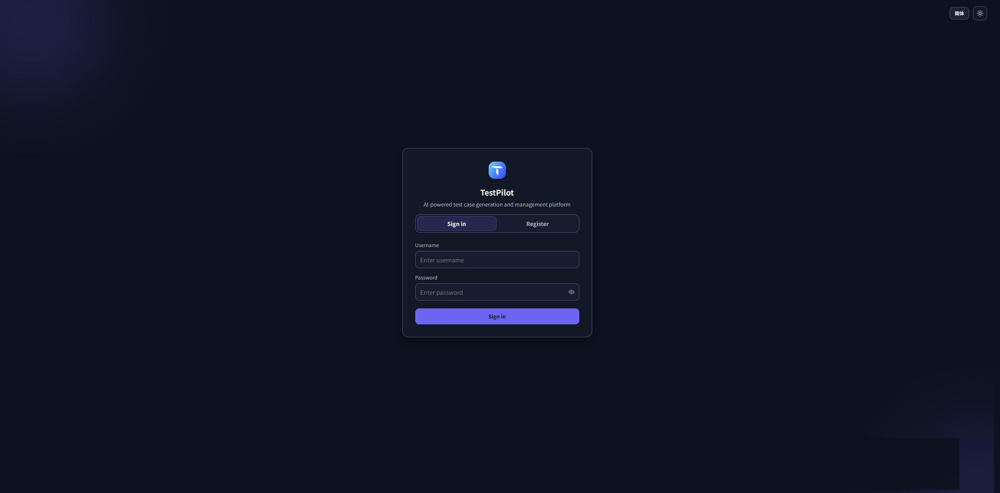
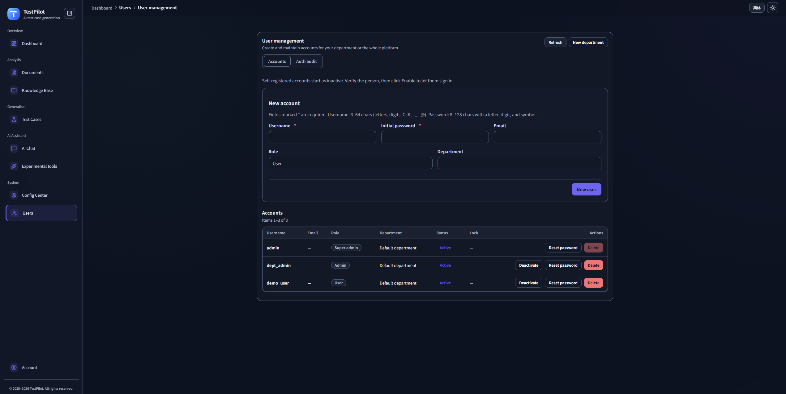

# Operations

Install, first-time setup, sign-in, daily use, deployment, tests, and troubleshooting. Product background and architecture stay in the [English overview](../README_en.md).

Environment variables, the vector store, and model setup (including Anthropic / Claude) are in [Configuration](CONFIGURATION.en.md).

## Quick Start

### Requirements

- Python 3.11+ (`numpy==2.3.3` and `scipy==1.16.2` require 3.11 or later)
- Node.js 18+ (optional, for frontend dev; Vite 6 requires Node 18 or later)
- 4GB+ RAM
- 2GB+ disk
- **Important**: PyTorch is removed; we use FastEmbed (ONNX/CPU), no GPU needed.

> **Note for Git**: `models/fastembed/` is a FastEmbed/HuggingFace model cache directory and can be large, so it should be ignored by `.gitignore` and not committed.  
> - **Online**: if the cache is missing, the embedding model will be downloaded automatically on first use.  
> - **Offline / packaged**: run `python scripts/preload_fastembed_models.py` on an online machine first and set `FASTEMBED_CACHE_DIR` if needed.

### Installation

1. **Clone**

```bash
git clone https://github.com/zhoujun94511/TestPilot-vue.git
cd TestPilot-vue
```

1. **Virtualenv**

```bash
python -m venv venv
# Windows
venv\Scripts\activate
# Linux/Mac
source venv/bin/activate
```

1. **Install deps**

```bash
pip install -r requirements.txt
```

1. **Initialize frontend (Vue 3 + Vite)**

```bash
cd frontend
npm install
```

Common frontend commands:
```bash
# Start Vue dev server (Vite)
npm run dev

# Build production bundle
npm run build

# Preview built assets locally
npm run preview
```

Integration notes:
- Frontend connects to backend via `VITE_FLASK_TARGET` in `frontend/.env.development.local`.
- Recommended: run `python run.py` at repo root to handle backend startup and frontend target sync.
- For frontend-only debugging, run `cd frontend && npm run dev`.

Frontend troubleshooting:
- `npm install` fails: verify Node.js version (recommended 18+), then run `npm cache clean --force` and retry.
- `npm run dev` port already in use: switch to another port or stop the conflicting process.
- API requests fail in UI: verify `VITE_FLASK_TARGET` in `frontend/.env.development.local`.
- Blank page / static 404: remove `frontend/node_modules`, reinstall dependencies, and start again.
- CORS issues during integration: prefer `python run.py` so backend CORS and frontend target stay aligned.

1. **Preload embedding models (required for offline)**

```bash
# Default model (baai/bge-small-en-v1.5, dim=384)
python scripts/preload_fastembed_models.py

# Or specify model
python scripts/preload_fastembed_models.py --model baai/bge-base-en-v1.5

# Custom cache dir (optional)
export FASTEMBED_CACHE_DIR=/path/to/cache
python scripts/preload_fastembed_models.py
```

> For fully offline deployment, preload the model on an online machine, copy `~/.cache/fastembed` (or your custom cache) to the target, and set `FASTEMBED_CACHE_DIR`.

1. **Configure environment**

```bash
cp .env.example .env
# Edit .env and fill in required values
```

**Authentication (team / multi-user deployments — see [AUTH-RBAC.en.md](AUTH-RBAC.en.md))**:

```bash
AUTH_REQUIRE_AUTH=true   # set false only for single-user anonymous mode
AUTH_REGISTER_ENABLED=false
AUTH_REGISTER_REQUIRE_APPROVAL=true   # self-registered accounts stay inactive until an admin enables them
AUTH_TRUST_PROXY_HEADERS=false        # enable only behind a trusted reverse proxy
AUTH_BOOTSTRAP_SUPER_USERNAME=admin
AUTH_BOOTSTRAP_SUPER_PASSWORD=
AUTH_BOOTSTRAP_ADMIN_USERNAME=manager
AUTH_BOOTSTRAP_ADMIN_PASSWORD=
AUTH_BOOTSTRAP_USER_USERNAME=member
AUTH_BOOTSTRAP_USER_PASSWORD=
```

Leave the passwords empty to use the built-in `TestPilot@2026` for all three. Set `AUTH_BOOTSTRAP_SUPER_PASSWORD` to share one password. The login page does not show these values.

1. **First-time setup (database, three accounts, config center, vector file)**

The first `python run.py` does this once and writes marker `first_run` in `app_bootstrap_markers`. Later starts only add missing tables or columns. They do not rewrite accounts, config values, or vectors.

To run the same step without leaving the server up:

```bash
python scripts/init_first_run.py
```

If the marker already exists, the script exits and leaves data unchanged. These commands wipe data and are not part of first-time setup:

```bash
python scripts/init_db.py clear
python scripts/init_vectordb.py --init-vector-db
python scripts/init_config_center.py --force
```

**Key vector-store related config** (current default is SQLite + sqlite-vec; ChromaDB is deprecated and kept only for rollback):

```bash
# Vector backend (default sqlite; historically sqlite/chroma, now sqlite is recommended)
VECTOR_BACKEND=sqlite

# Embedding
EMBEDDING_MODEL_NAME=baai/bge-small-en-v1.5
EMBEDDING_DIM=384  # must match actual model; cannot change without rebuilding DB

# SQLite vector store
SQLITE_VECTOR_DB_PATH=  # default: vector_store/vector_store.db
SQLITE_VEC_EXTENSION_PATH=  # optional sqlite-vec extension path

# Hybrid retrieval
ENABLE_HYBRID_RETRIEVAL=true
FTS_CANDIDATE_K=200  # legacy; still supported for compatibility
```

1. **Run app**

```bash
python run.py
```

1. **Open UI and sign in**

- Dev mode (hot reload, recommended): open `http://localhost:5173`.
- Built frontend (run `npm run build` first): open `http://localhost:5001`.

Sign in with one of the accounts created on first run. The login page does not prefill a username or tell you which account to use.

| Role | Default username | After sign-in |
|------|------------------|---------------|
| Super admin | `admin` | Config Center, user management, all data |
| Admin | `manager` | Department users and department data |
| User | `member` | Department data only |

If no `AUTH_BOOTSTRAP_*_PASSWORD` is set, the password for all three is `TestPilot@2026`. Change it from **Account** at the bottom of the sidebar. Config Center is visible to the super admin only.

### Reset local data

Stop the backend first, then run (both commands ask for `y`):

```bash
# All rows in testpilot.db, including config center tables, users and departments; ends with VACUUM
python scripts/init_db.py clear
# All documents, chunks, vectors and FTS data in vector_store/vector_store.db
python scripts/init_vectordb.py --clear-vector-db
```

`init_db.py clear` also deletes the first-run marker. The next start is a new first run: it recreates the three accounts and missing config defaults. It does not keep passwords or config edits from before the clear. Both clear commands delete rows and keep the table structure. Vector clear does not remove the marker. Before committing, delete files inside `uploads/`, `downloads/`, and `logs/` while leaving the directories in place. Those three directories are gitignored. `python scripts/init_config_center.py --force` rewrites built-in defaults (`DEFAULT_COMPANY=OPENAI`) and overrides the `.env` provider, so use it only to restore factory config.

## Usage Guide (Overview)

- **Test Case Generation**: single/batch requirements, RAG, negative cases, optimization, hallucination detection.
- **Requirement Analysis**: file upload or text input, extract test points and rules.
- **Knowledge Base**: upload docs, smart retrieval, RAG integration.
- **AI Assistant**: testing Q&A, templates, context-aware chat.
- **Hallucination Detection**: automatic checks, strategies, and thresholds.
- **Config Center**: manage configs, priorities, audit trail sidebar, token limits under **AI model** (`MAX_TOKENS`, unified `TR_MAX_TOKENS`, session caps), export/import, and sensitive fields.

See [CONFIG-CENTER.en.md](CONFIG-CENTER.en.md) and [TOKEN-CONFIG.md](../frontend/docs/TOKEN-CONFIG.md). Day-to-day steps in Chinese are in [操作文档](OPERATIONS.md).

## API Documentation (High-level)

Main endpoints (paths are the same as in the Chinese README):

- `/api/cases/*` for test cases
- `/api/documents/*` and `/api/requirements` for requirement docs
- `/api/knowledge/*` for knowledge base
- `/api/chat/*` for chat sessions and history
- `/api/export/*` for exporting data
- `/api/hallucination/*` for hallucination detection and reports
- `/api/config/*` for config center
- `/api/stats/*` for stats and health

## Testing

- **System tests**: `python scripts/test_system.py`
- **Vector pipeline tests**: `tests/vector_pipeline` (pytest)
- **Hallucination tests**: `scripts/test_chat_hallucination.py`, `scripts/run_hallucination_tests.py`

Coverage includes health checks, UI, static assets, APIs, test generation, requirement analysis, knowledge base, chat, hallucination detection, config center, smart retrieval, keyword extraction, exports, statistics, and vector store behavior.

Lightweight RBAC integration tests (no full LLM stack): `pytest tests/test_rbac_integration_light.py`

## Authentication and RBAC

Login and **department-scoped data** (cases, requirements, knowledge, chat, export, stats) are on by default. First-time setup creates a super admin, an admin, and a regular user. Pick one at the login page. Set **`AUTH_REQUIRE_AUTH=false`** only for single-user anonymous mode.

| Topic | Details |
|-------|---------|
| Full doc | [AUTH-RBAC.en.md](AUTH-RBAC.en.md) |
| Initial accounts | Once, on first run: `admin`, `manager`, `member`. The marker blocks later resets |
| Password | `AUTH_BOOTSTRAP_*_PASSWORD`, or `TestPilot@2026` when all are empty. Not shown in the UI |
| Migrations | App start or `python scripts/init_first_run.py` |

For production: set a strong bootstrap password. `AUTH_REQUIRE_AUTH` already defaults to true. Be careful with `AUTH_REGISTER_ENABLED`.




## Deployment Guide

### Production

- Use `gunicorn` + `eventlet` to run the app (e.g. `gunicorn --bind 0.0.0.0:5001 --workers 4 --worker-class eventlet app:create_app()`).  
- Exact production commands are in the Chinese [操作文档](OPERATIONS.md) section “生产环境部署”.

### Cloud

Supported on AWS, Azure, GCP, Alibaba Cloud, Tencent Cloud via containers or services like ECS/Cloud Run/App Service, etc.

## Known Limitations

- **Embedding dimension fixed**: `EMBEDDING_DIM` cannot be changed without rebuilding the vector DB (sqlite-vec requirement).
- **SQLite IN limit**: handled via batching; keep `FTS_CANDIDATE_K < 999` for safety.
- **sqlite-vec optional**: missing extension leads to slower but functional fallback.
- **FTS5 consistency**: handled with transactional deletes and verification tools.
- **Distance→similarity mapping**: assumes `vec_distance_cosine` in [0, 2]; check if upgrading sqlite-vec.

## Troubleshooting

Common issues and solutions are the same as described in the Chinese README:

- App startup failures
- Embedding dimension mismatch
- sqlite-vec extension loading failures
- AI API errors
- DB connection problems
- Upload failures
- Hybrid retrieval performance issues

See logs under `logs/` for detailed diagnostics.

## Contributing

We welcome all contributions!

- **Report issues** via GitLab Issues.
- **Submit code** via Merge Requests.
- **Improve docs** (including translations).
- **Test & feedback** for new features.

Basic workflow:

```bash
git clone https://github.com/zhoujun94511/TestPilot-vue.git
cd TestPilot-vue
git checkout -b feature/your-feature-name
pip install -r requirements-dev.txt
python -m pytest tests/
```

Please follow PEP 8, use meaningful names, add docstrings where helpful, and ensure tests cover new functionality.

