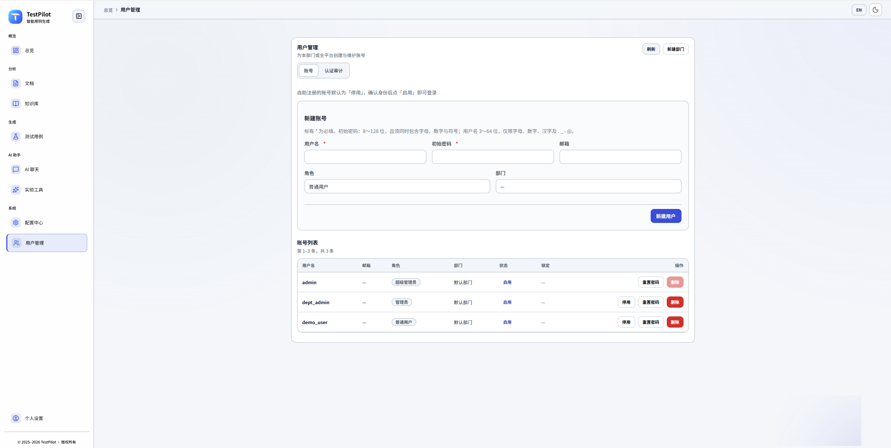

# 操作文档

安装、首次初始化、登录、日常使用、部署、测试和排障。品牌、背景和架构见 [项目介绍](../README.md)。

配置项、向量库和模型（含 Anthropic / Claude）见 [配置说明](CONFIGURATION.md)。

## 快速开始

### 环境要求

- Python 3.11+（`numpy==2.3.3`、`scipy==1.16.2` 要求 3.11 及以上）
- Node.js 18+（可选，用于前端开发；Vite 6 要求 Node 18 及以上）
- 4GB+ RAM
- 2GB+ 磁盘空间
- **重要**：项目已去 PyTorch，使用 FastEmbed (ONNX/CPU)，无需 GPU

> **注意（Git 提交）**：`models/fastembed/` 是 FastEmbed/HuggingFace 的模型缓存目录，体积较大，默认应由 `.gitignore` 忽略，不建议提交到仓库。  
> - **联网运行**：若本机缓存缺失，首次使用 embedding 时会自动下载。  
> - **离线/打包运行**：请在有网环境先执行 `python scripts/preload_fastembed_models.py` 预下载模型，并按需设置 `FASTEMBED_CACHE_DIR`。

### 安装步骤

1. **克隆项目**
```bash
git clone https://github.com/zhoujun94511/TestPilot-vue.git
cd TestPilot-vue
```

2.**创建虚拟环境**
```bash
python -m venv venv
# Windows
venv\Scripts\activate
# Linux/Mac
source venv/bin/activate
```

3.**安装依赖**
```bash
pip install -r requirements.txt
```

3.1 **初始化前端（Vue 3 + Vite）**
```bash
cd frontend
npm install
```

常用前端命令：
```bash
# 启动 Vue 开发服务（默认 Vite）
npm run dev

# 构建生产包
npm run build

# 本地预览构建结果
npm run preview
```

联调说明：
- 前端通过 `VITE_FLASK_TARGET` 连接后端（配置文件：`frontend/.env.development.local`）
- 推荐直接在项目根目录运行 `python run.py`，会自动处理后端启动与前端联调配置
- 如需独立调试前端，可手动执行 `cd frontend && npm run dev`

前端常见问题排查：
- `npm install` 失败：先确认 Node.js 版本（建议 18+），再执行 `npm cache clean --force` 后重试
- `npm run dev` 启动报端口占用：按终端提示更换端口，或先释放占用端口进程
- 页面接口请求失败：检查 `frontend/.env.development.local` 中 `VITE_FLASK_TARGET` 是否指向正确后端地址
- 页面空白/资源 404：删除 `frontend/node_modules` 后重新 `npm install`，再执行 `npm run dev`
- 联调跨域异常：优先使用 `python run.py` 启动，确保后端 CORS 与前端目标地址一致

**注意**：项目已移除 PyTorch、sentence-transformers、transformers 依赖，使用轻量级 FastEmbed (ONNX)。

4**预下载 Embedding 模型（离线部署必需）**

 **首次部署必须预下载模型，否则会隐式访问外网**

```bash
# 下载默认模型（BAAI bge-small-en-v1.5，维度 384）
python scripts/preload_fastembed_models.py

# 或指定模型（BAAI）
python scripts/preload_fastembed_models.py --model baai/bge-base-en-v1.5

# 指定缓存目录（可选）
export FASTEMBED_CACHE_DIR=/path/to/cache
python scripts/preload_fastembed_models.py
```

**离线部署**：如果目标环境无外网，可在有网环境预下载后，将缓存目录（默认 `~/.cache/fastembed`）复制到目标环境，并设置 `FASTEMBED_CACHE_DIR` 环境变量。

5.**配置环境变量**
```bash
cp .env.example .env
# 编辑 .env 文件，配置必要的环境变量
```

**认证相关（团队/多用户部署建议阅读 [AUTH-RBAC.md](AUTH-RBAC.md)）**：

```bash
# 默认 true：除公开认证接口外都要登录。单机匿名可改为 false
AUTH_REQUIRE_AUTH=true
AUTH_REGISTER_ENABLED=false
# 开放注册时，新账号默认停用，管理员启用后才能登录
AUTH_REGISTER_REQUIRE_APPROVAL=true
# 只有部署在可信反向代理之后才开启
AUTH_TRUST_PROXY_HEADERS=false
# 首次初始化写三类账号。密码留空时用内置默认密码，见下方「首次登录」
AUTH_BOOTSTRAP_SUPER_USERNAME=admin
AUTH_BOOTSTRAP_SUPER_PASSWORD=
AUTH_BOOTSTRAP_ADMIN_USERNAME=manager
AUTH_BOOTSTRAP_ADMIN_PASSWORD=
AUTH_BOOTSTRAP_USER_USERNAME=member
AUTH_BOOTSTRAP_USER_PASSWORD=
```

6.**首次初始化（业务库、三类账号、配置中心、向量库）**

`python run.py` 第一次启动会自己做完，并在表 `app_bootstrap_markers` 写入游标 `first_run`。之后再启动只补表结构，不会重写账号、配置或向量数据。

不想等启动、想先单独做完初始化时，用同一条逻辑：

```bash
python scripts/init_first_run.py
```

游标已存在时脚本直接退出。下面三个命令会清空数据，不是首次使用步骤：

```bash
python scripts/init_db.py clear
python scripts/init_vectordb.py --init-vector-db
python scripts/init_config_center.py --force
```

7.**首次登录（必做）**：登录页不预填账号，也不提示该用哪个。请自行选择下面其中一个。未在 `.env` 单独设置密码时，三个账号的密码都是 `TestPilot@2026`；设置了 `AUTH_BOOTSTRAP_SUPER_PASSWORD` 且另外两个密码留空时，三个账号都用超管密码。登录后在侧栏底部 **个人管理** 修改密码。

| 角色 | 默认用户名 | 登录后能做什么 |
|------|------------|----------------|
| 超级管理员 | `admin` | 配置中心、用户管理、全部数据 |
| 管理员 | `manager` | 本部门用户和业务数据 |
| 普通用户 | `member` | 本部门业务数据，无配置中心、无用户管理 |

**关键配置项**（向量存储相关，当前默认使用 SQLite + sqlite-vec，ChromaDB 已废弃，仅保留回滚兼容）：
```bash
# 向量存储后端（默认 sqlite，历史上支持 sqlite/chroma，当前推荐仅使用 sqlite）
VECTOR_BACKEND=sqlite

# Embedding 模型配置（必须与实际模型一致）
EMBEDDING_MODEL_NAME=baai/bge-small-en-v1.5
EMBEDDING_DIM=384  # 重要：维度一旦确定，不允许再变更（sqlite-vec 要求）

# SQLite 向量存储配置（可选）
SQLITE_VECTOR_DB_PATH=  # 如果为空，使用 vector_store/vector_store.db
SQLITE_VEC_EXTENSION_PATH=  # sqlite-vec 扩展路径（可选，未设置时自动尝试加载）

# 混合检索配置
ENABLE_HYBRID_RETRIEVAL=true  # 是否启用混合检索（FTS5 + sqlite-vec）
FTS_CANDIDATE_K=200  # FTS5 召回候选数量（默认 200，适用于 topK=5~10）
```

8.**向量数据库**

首次启动或 `python scripts/init_first_run.py` 会在文件不存在时创建 `vector_store/vector_store.db`，不会清空已有向量。`python scripts/init_vectordb.py --init-vector-db` 会清空向量，只在确认要丢掉知识库向量时使用。

**说明**：
- SQLite 向量数据库文件默认位置：`vector_store/vector_store.db`
- 数据库包含以下表：
  - `documents`：文档元数据
  - `chunks`：文档块
  - `chunk_embeddings`：向量数据（BLOB 格式，float32 buffer）
  - `chunk_fts`：FTS5 全文索引（虚拟表）
- vec0 虚拟表：当前实现直接使用 `chunk_embeddings` 表 + `vec_distance_cosine` 函数，不再维护单独的虚拟表

9.**配置中心**

首次初始化会写入还没有的配置项和验证规则，`DEFAULT_COMPANY` 跟当时的 `.env` 一致，并记下游标。游标写入后，再启动不会补回你删掉的配置，也不会覆盖改过的值。

只有要恢复出厂配置时才用强制重置（会清空后写入内置默认，并把提供商改成 `OPENAI`）：

```bash
python scripts/init_config_center.py --force
```

10.**启动应用**
```bash
python run.py
```

11.**访问应用**
```
开发模式（热更新，推荐）：打开 http://localhost:5173
构建后的页面（需先 npm run build）：打开 http://localhost:5001
```

**注意**：首次进入是登录页，自行选择第 7 步里的一个账号。配置中心只有超级管理员能看见。登录页不展示默认账号或密码。

### 清空本地数据（提交前或重置环境）

先停止后端，再执行：

```bash
# 业务库：清空 testpilot.db 全部表数据（保留表结构），含配置中心三张表和用户/部门
python scripts/init_db.py clear
# 向量库：清空 vector_store/vector_store.db 中的文档、chunk、向量和 FTS 索引
python scripts/init_vectordb.py --clear-vector-db
```

| 脚本 | 清空内容 | 清空后的行为 |
|------|----------|--------------|
| `init_db.py clear` | 用例、需求、聊天会话与历史、工具执行审计、模型用量、系统日志、性能指标、知识文件记录、配置中心（配置项、验证规则、变更审计）、用户、登录会话、认证审计、部门、首次初始化游标 | 下次启动视为新的首次初始化，重建三类账号和配置缺省项 |
| `init_vectordb.py --clear-vector-db` | 全部向量数据 | 知识库检索和 RAG 无结果，需重新上传知识文件 |
| `init_config_center.py --force` | 仅配置中心的配置项和验证规则，随后写入脚本内置默认值 | 内置默认 `DEFAULT_COMPANY=OPENAI`，会覆盖 `.env` 的提供商，只在需要恢复出厂配置时使用 |

两个清空命令都会要求输入 `y` 确认，并且只删除行、保留表结构。`init_db.py clear` 结束时会执行 VACUUM 收缩数据库文件。提交前再删除 `uploads/`、`downloads/`、`logs/` 里面的文件，目录本身保留。这三项目录已写入 `.gitignore`，不会被提交。

### 离线部署完整流程

1. **在有网环境预下载模型**
```bash
python scripts/preload_fastembed_models.py
```

1. **复制缓存目录到目标环境**
```bash
# 源环境
cp -r ~/.cache/fastembed /path/to/offline/cache

# 目标环境
export FASTEMBED_CACHE_DIR=/path/to/offline/cache
```

1.**安装依赖（无需外网）**
```bash
pip install -r requirements.txt
```

1.**初始化数据库和向量库**
```bash
python scripts/init_db.py
python scripts/init_vectordb.py --init-vector-db
```

1.**启动应用**
```bash
python run.py
```

## 使用指南

### 1. 测试用例生成

1. **单个需求生成**
   - 在"用例生成"页面输入需求描述
   - 设置生成参数（数量、优先级等）
   - 点击"生成测试用例"

2. **批量生成**
   - 点击"批量生成"按钮
   - 输入多个需求（每行一个）
   - 设置批量处理参数

3. **高级选项**
   - 启用RAG增强：使用知识库优化生成质量
   - 包含负面用例：生成异常和边界测试场景
   - 自动优化：基于历史数据优化用例
   - 幻觉检测：自动检测并处理生成内容中的质量问题

### 2. 需求分析

1. **文档上传**
   - 选择"文件上传"方式
   - 上传需求文档（支持多种格式）
   - 选择分析类型并执行分析

2. **文本分析**
   - 选择"文本输入"方式
   - 直接粘贴需求文本
   - 执行智能分析

### 3. 知识库管理

1. **文件上传**
   - 选择知识文件并设置分类
   - 添加文件描述
   - 上传到知识库

2. **智能检索**
   - 输入搜索关键词或问题
   - 系统自动选择最佳检索策略（语义/关键词/混合/上下文感知）
   - 查看检索结果和相关性评分
   - 支持查看原文和上下文信息

3. **检索优化**
   - 智能重排序：根据相关性自动排序结果
   - 查询扩展：自动提取关键词扩展查询
   - 上下文感知：利用对话上下文提升检索准确性

### 4. AI助手对话

1. **开始对话**
   - 在聊天界面输入问题
   - 选择是否使用上下文和知识库
   - 获取AI助手的专业建议

2. **使用模板**
   - 选择预置的对话模板
   - 根据提示填写相关信息
   - 获取针对性的建议

### 5. 幻觉检测功能

1. **自动检测**
   - 系统会自动检测AI生成内容中的幻觉问题
   - 支持模式匹配、逻辑分析、置信度评估
   - 实时显示检测结果和处理建议

2. **处理策略**
   - 警告模式：低置信度问题，仅提示用户注意
   - 自动修正：中等置信度问题，尝试自动修正
   - 重新生成：高置信度问题，使用LLM重新生成
   - 人工审核：严重问题，标记为需要人工审核
   - 过滤处理：极严重问题，直接过滤掉

3. **配置管理**
   - 可在配置中心调整检测阈值
   - 支持启用/禁用幻觉检测功能
   - 可自定义处理策略和阈值参数

### 6. 配置中心管理

1. **访问配置中心**
   - 导航栏进入 **配置中心**
   - 左侧切换分类；**最近配置变更** 为只读审计列表（独立页面布局）

2. **配置管理**
   - 按分类编辑并保存（支持 dirty 提示、顶栏刷新）
   - **AI 模型设置**：Provider 开关与密钥；**单次最大词元数** 分区（聊天 / 用例与需求 / 会话熔断）
   - 导出、导入（审计页不提供）
   - 校验失败时字段级或 Toast 提示

3. **配置优先级**
   - 配置中心 > `.env` > 系统默认值

4. **敏感配置**
   - API 密钥等掩码显示，可切换显示明文

详细 API 与初始化见 [CONFIG-CENTER.md](CONFIG-CENTER.md)（英文版 [CONFIG-CENTER.en.md](CONFIG-CENTER.en.md)）。

## API文档

### 主要API端点

#### 测试用例相关
- `POST /api/cases/generate` - 生成测试用例
- `GET /api/cases` - 获取测试用例列表
- `GET /api/cases/{id}` - 获取单个测试用例
- `PUT /api/cases/{id}` - 更新测试用例
- `DELETE /api/cases/{id}` - 删除测试用例

#### 需求分析相关
- `POST /api/documents/upload` - 上传文档
- `POST /api/documents/analyze` - 分析内容
- `GET /api/documents` - 获取文档列表
- `GET /api/requirements` - 获取需求列表

#### 知识库相关
- `POST /api/knowledge/upload` - 上传知识文件
- `POST /api/knowledge/search` - 搜索知识库
- `GET /api/knowledge/files` - 获取文件列表
- `DELETE /api/knowledge/files/{id}` - 删除知识文件

#### 聊天相关
- `POST /api/chat/sessions` - 创建聊天会话
- `POST /api/chat/message` - 发送消息
- `GET /api/chat/sessions` - 获取会话列表
- `GET /api/chat/history/{session_id}` - 获取聊天历史

#### 实验动作编排（可选，默认关闭）
实验接口默认可用。显式设置 `ENABLE_EXPERIMENTAL_ACTIONS=false` 后返回 403。

**与聊天通道分离（不兼容旧客户端）**：`/api/chat/message` 与 `POST /api/chat/stream` 仅支持 `mode=chat`；`mode=action` 一律 **400** `action_mode_not_supported`。`GET /api/chat/stream` 不接受，避免消息正文出现在 URL 里。，响应体含 `experimental_actions.execute` 等指引。对话与智能建议走 LLM；工具请走下方 execute，**必须**显式 `tool_name` + `args`（侧栏「实验工具」页 `/experimental-tools`）。默认 **关闭** NL 推断（无 `tool_name` → 400 `explicit_tool_required`）；脚本调试可设 `EXPERIMENTAL_ACTIONS_ALLOW_NL=true`，此时模糊句可能 `skipped` 而非误执行 list。

- `GET /api/experimental-actions/health` - 查询实验动作能力状态与已注册工具
- `POST /api/experimental-actions/execute` - 执行动作（显式 `tool_name`/`args` 或 NL 推断；高风险默认待确认；`done`/`failed` 且带 `session_id` 时会写入聊天历史）
- `POST /api/experimental-actions/confirm` - 确认执行待确认动作
- `POST /api/experimental-actions/cancel` - 取消待确认动作
- `GET /api/experimental-actions/execution/{execution_id}` - 查询执行详情与审计状态

**维护约定**：后端工具在 `experiments/action_runtime/orchestrator.py` 注册；实验工具页表单在 `frontend/src/config/experimentalTools.ts`，页面为 `frontend/src/views/ExperimentalToolsView.vue`。新增/改名工具须两处同步，否则 execute 可能返回 `unknown_tool` 或页面缺字段。非法 `tool_name` 在显式模式下返回 **400** `unknown_tool`，且 **不会** 回退 NL 推断。

**怎么用（测试同学生路径）**

1. 实验工具默认可用。侧栏「AI 助手」分组里，「实验工具」在「AI 聊天」下方，所有已登录用户可见（未配置角色限制）。只有后端显式关闭时，页面才会提示不可用。
2. **日常讨论**：在 AI 聊天页用输入框或智能建议，走 LLM 对话（不会自动列库内用例）。
3. **真要落库或列出数据**：打开侧栏「实验工具」，选工具后点「运行工具」。
   - 「列出用例」等：多数可直接运行（已有默认条数）。
   - 「生成用例」：在「需求描述」里填写需求，再 **运行工具**。切换到「分析文档内容」时已填的长文本会自动带过去。
   - 聊天页智能建议含「设计/生成 + 用例」时：普通点击仍 **发送对话**；**Shift+点击** 跳到实验工具页并预填「生成用例」，不发送对话。
4. 删除用例等高风险操作：运行后在同页确认，并输入 `DELETE`。

#### 导出相关
- `GET /api/export/cases` - 导出测试用例
- `GET /api/export/requirements` - 导出需求
- `GET /api/export/template/{type}` - 获取导出模板

#### 幻觉检测相关
- `POST /api/hallucination/detect` - 检测内容中的幻觉问题
- `GET /api/hallucination/report/{id}` - 获取检测报告
- `POST /api/hallucination/handle` - 处理检测到的幻觉问题
- `GET /api/hallucination/config` - 获取幻觉检测配置

#### 配置中心相关
- `GET /api/config/categories` - 获取配置分类
- `GET /api/config/<category>` - 获取指定分类的配置
- `POST /api/config/<category>` - 批量更新指定分类的配置
- `GET /api/config/item/<key>` - 获取单个配置项
- `PUT /api/config/item/<key>` - 更新单个配置项
- `DELETE /api/config/item/<key>` - 删除配置项
- `GET /api/config/export` - 导出配置
- `POST /api/config/import` - 导入配置
- `GET /api/config/audit-logs` - 获取配置审计日志
- `POST /api/config/validate/<key>` - 校验配置项

#### 统计相关
- `GET /api/stats/overview` - 获取概览统计
- `GET /api/stats/performance` - 获取性能指标
- `GET /api/stats/health` - 健康检查

详细的API文档请参考 `/docs` 目录或在线文档。

## 测试

### 运行系统测试

```bash
# 启动应用后运行测试
python scripts/test_system.py

# 指定测试目标（也可跳过，项目已支持启动时自动打开对应网页）
python scripts/test_system.py http://localhost:5001
```

### 运行向量存储白盒测试

```bash
# 进入测试目录
cd tests/vector_pipeline

# 设置环境变量（必需）
export EMBEDDING_MODEL_NAME=baai/bge-small-en-v1.5
export EMBEDDING_DIM=384
export VECTOR_BACKEND=sqlite
export ENABLE_HYBRID_RETRIEVAL=true
export FTS_CANDIDATE_K=200

# 运行测试（Windows）
run_tests.bat

# 运行测试（Linux/Mac）
chmod +x run_tests.sh
./run_tests.sh

# 或使用 pytest 直接运行
pytest tests/vector_pipeline/ -v
```

**测试覆盖**：
-  sqlite-vec 索引创建和查询
-  FTS5 全文索引创建和查询
-  混合检索两阶段流程
-  **雷点 1**：SQLite IN 参数上限（FTS_CANDIDATE_K ∈ [950, 999]）
-  **雷点 2**：embedding buffer 长度校验（len(buffer) == dim * 4）
-  **雷点 3**：FTS 与 chunks 一致性（无幽灵数据）
-  Fallback 路径（扩展不可用时的行为）

### 测试覆盖范围

-  健康检查
-  页面访问
-  静态文件加载
-  API端点检查
-  测试用例生成
-  需求分析
-  知识库管理
-  AI助手对话
-  幻觉检测功能
-  配置中心管理
-  智能检索策略
-  关键词提取增强
-  数据导出
-  统计功能
- **向量存储**（SQLite + sqlite-vec + FTS5）

### 幻觉检测测试

```bash
# 运行幻觉检测功能测试
python scripts/test_chat_hallucination.py

# 运行完整的白盒测试
python scripts/run_hallucination_tests.py --full

# 运行快速测试
python scripts/run_hallucination_tests.py --quick
```

## 认证与 RBAC

TestPilot 默认开启登录与 **部门级数据隔离**（用例、需求、知识库、聊天、导出、统计等）。首次初始化创建超级管理员、管理员、普通用户各一个，登录时自行选择。若要恢复单机匿名模式，在 `.env` 中设置 `AUTH_REQUIRE_AUTH=false`。

| 项目 | 说明 |
|------|------|
| 详细文档 | [AUTH-RBAC.md](AUTH-RBAC.md) |
| 初始账号 | 仅首次初始化创建：`admin`（super_admin）、`manager`（admin）、`member`（user）。游标写入后不再补建或重置 |
| 密码 | `AUTH_BOOTSTRAP_*_PASSWORD`；都留空时为 `TestPilot@2026`。界面不提示 |
| 数据库迁移 | 启动或 `python scripts/init_first_run.py` → 建表、迁移、首次种子 |
| 前端 | 登录页不预填账号；`/admin/users`（admin/super_admin）；配置中心仅 super_admin |

生产请务必：设置强引导密码，并审慎使用 `AUTH_REGISTER_ENABLED`。




## 部署指南

### 生产环境部署

1. **环境准备**
```bash
# 设置生产环境变量
export FLASK_ENV=production
export DEBUG=False
export SECRET_KEY=your-production-secret-key
```

1. **使用Gunicorn部署**
```bash
gunicorn --bind 0.0.0.0:5001 --workers 4 --worker-class eventlet app:create_app()
```

### 云平台部署

支持部署到各大云平台：
- **AWS**: ECS, Lambda, EC2
- **Azure**: Container Instances, App Service
- **Google Cloud**: Cloud Run, Compute Engine
- **阿里云**: ECS, 函数计算
- **腾讯云**: CVM, 云函数

## 已知工程限制

### 1. Embedding 维度不可变

**重要约束**：`EMBEDDING_DIM` 一旦确定，不允许再变更（sqlite-vec 要求）

**原因**：向量数据库的 schema 依赖维度，变更维度会导致数据不兼容

**解决方法**：
- 变更维度前，必须重建向量库：
  ```bash
  python scripts/init_vectordb.py --init-vector-db
  ```
- 确保 `EMBEDDING_DIM` 与实际模型维度一致（启动时会自动校验）

### 2. SQLite IN 参数上限（已修复）

**已知限制**：SQLite 默认 IN 参数上限为 999

**影响**：如果 `FTS_CANDIDATE_K >= 999`，混合检索第二阶段可能触发上限

**已修复**（P0-1）：
- 自动检测候选数量 >= 999
- 自动分批处理（批次大小 800）
- 合并结果后统一排序
- 有明确的 `warning` 日志记录

**建议**：保持 `FTS_CANDIDATE_K < 999`（默认 200 是安全的）

### 3. sqlite-vec 扩展依赖

**可选依赖**：sqlite-vec 扩展用于向量索引加速

**行为**：
- 扩展可用：使用 `vec_distance_cosine` 函数（高性能）
- 扩展不可用：自动降级到全表扫描（纯 Python 计算，性能较差但可用）

**扩展加载**：
- 自动尝试从常见位置加载（`/usr/local/lib/vec0.so` 等）
- 可通过 `SQLITE_VEC_EXTENSION_PATH` 指定扩展路径
- 加载失败不影响功能，仅影响性能

**说明**：这是"设计行为"，不是 bug。系统设计为在扩展不可用时自动降级，确保功能可用。

### 4. FTS5 与 chunks 一致性

**已知风险**：FTS5 是虚拟表，不 enforce 外键约束

**已修复**（P0-2）：
- `delete()` 方法中同时删除 FTS5 数据（事务保证）
- 提供 `_verify_fts_chunks_consistency()` 调试工具（检测幽灵数据）
- 删除后自动验证一致性（仅记录 warning，不影响主流程）

**说明**：FTS5 虚拟表没有外键约束，但通过事务和同步删除保证一致性。

### 5. distance → similarity_score 映射假设

**映射假设**：当前实现假设 `vec_distance_cosine` 返回范围 [0, 2]

**映射公式**：
```text
similarity = max(0.0, 1.0 - distance / 2.0)
# distance = 0 → similarity = 1.0（最相似）
# distance = 2 → similarity = 0.0（最不相似）
```

**注意**：
- 如果未来升级 sqlite-vec 版本，需要验证 distance 范围是否仍为 [0, 2]
- 如果范围变化，需要调整映射公式
- 建议在初始化时测试 distance 范围并记录日志

## 故障排除

### 常见问题

1. **应用启动失败**
   - 检查Python版本（需要3.11+）
   - 确认所有依赖已正确安装
   - 检查环境变量配置

2.**Embedding 模型加载失败**

**错误**：`维度不匹配！配置维度 (EMBEDDING_DIM): 384, 实际模型维度: 768`

**原因**：配置的 `EMBEDDING_DIM` 与实际模型维度不一致

**解决方法**：
```bash
# 方法1：修改 EMBEDDING_DIM 环境变量
export EMBEDDING_DIM=768

# 方法2：使用维度为 384 的模型
export EMBEDDING_MODEL_NAME=baai/bge-small-en-v1.5
export EMBEDDING_DIM=384
```

**注意**：embedding 维度一旦确定，不允许再变更（sqlite-vec 要求）。变更维度需要重建向量库：
```bash
# 清空向量库
python scripts/init_vectordb.py --init-vector-db
```

1. **sqlite-vec 扩展加载失败**

**错误**：`无法加载 sqlite-vec 扩展`

**原因**：扩展文件不存在或 SQLite 未启用扩展支持

**解决方法**：
- 系统会自动降级到全表扫描模式（性能较差但可用）
- 如需使用索引，请：
  1. 下载 sqlite-vec 扩展文件
  2. 设置 `SQLITE_VEC_EXTENSION_PATH` 环境变量指向扩展文件
  3. 或确保扩展文件在常见位置（`/usr/local/lib/vec0.so` 等）

1.**AI模型调用失败**
   - 验证API密钥是否正确
   - 检查网络连接
   - 确认模型名称配置正确

2.**数据库连接问题**
   - 检查数据库URL配置
   - 确认数据库服务正在运行
   - 验证数据库权限

3.**文件上传失败**
   - 检查上传目录权限
   - 确认文件大小限制
   - 验证文件格式支持

4.**混合检索性能问题**

**现象**：检索速度慢

**可能原因**：
- sqlite-vec 扩展未加载，使用全表扫描
- `FTS_CANDIDATE_K` 设置过大

**解决方法**：
```bash
# 检查扩展是否加载（查看日志）
grep "sqlite-vec" logs/testpilot_*.log

# 调整 FTS_CANDIDATE_K（根据实际 topK 调整）
export FTS_CANDIDATE_K=100  # 如果 topK=5
```

### 日志查看

```bash
# 查看应用日志
tail -f logs/testpilot.log

# 查看错误日志
tail -f logs/error.log

# 查看访问日志
tail -f logs/access.log

# 查看向量存储相关日志（fallback、扩展加载等）
grep -E "sqlite-vec|FTS5|fallback|降级" logs/testpilot_*.log
```

### 回滚/切换后端

#### 从 SQLite 切换到 ChromaDB

```bash
# 1. 备份 SQLite 向量数据库
cp vector_store/vector_store.db vector_store/vector_store.db.backup

# 2. 修改环境变量
export VECTOR_BACKEND=chroma

# 3. 清空向量库（ChromaDB 会创建新的数据库）
python scripts/init_vectordb.py --init-vector-db

# 4. 重新导入知识库数据（如果需要）
# 通过 Web 界面上传知识文件，或使用批量导入脚本
```

**注意**：
- 切换后端后，需要重新导入所有向量数据
- 不支持自动迁移，需要手动重新导入
- embedding 维度变更需要重建向量库（无论哪个后端）

#### 从 ChromaDB 切换到 SQLite

```bash
# 1. 修改环境变量
export VECTOR_BACKEND=sqlite

# 2. 清空向量库（SQLite 会创建新的数据库）
python scripts/init_vectordb.py --init-vector-db

# 3. 重新导入知识库数据（如果需要）
```

### 快速验证命令

```bash
# 1. 设置环境变量（必需）
export VECTOR_BACKEND=sqlite
export EMBEDDING_MODEL_NAME=baai/bge-small-en-v1.5
export EMBEDDING_DIM=384
export ENABLE_HYBRID_RETRIEVAL=true
export FTS_CANDIDATE_K=200

# 2. 验证 Embedding 模型预下载
python scripts/preload_fastembed_models.py
# 预期输出：模型预下载成功

# 3. 验证向量数据库初始化
python scripts/init_vectordb.py --init-vector-db --dry-run
# 预期输出：预览模式，显示将执行的操作

# 4. 验证配置
python -c "from config.settings import settings; print('VECTOR_BACKEND=' + str(settings.VECTOR_BACKEND)); print('EMBEDDING_DIM=' + str(settings.EMBEDDING_DIM)); print('ENABLE_HYBRID_RETRIEVAL=' + str(settings.ENABLE_HYBRID_RETRIEVAL)); print('FTS_CANDIDATE_K=' + str(settings.FTS_CANDIDATE_K))"
# 预期输出：显示当前配置值

# 5. 运行向量存储白盒测试（关键验证）
cd tests/vector_pipeline
pytest -q
# 预期输出：所有测试通过，包括：
#   - sqlite-vec 索引测试
#   - FTS5 全文索引测试
#   - 混合检索测试（包括 IN 参数上限测试）
#   - Fallback 路径测试

# 6. 启动项目并验证
python run.py
# 预期：应用正常启动，无错误日志
# 检查日志中是否有 fallback 警告（正常情况，表示扩展未加载但功能可用）
```

## 贡献指南

我们欢迎任何形式的贡献！

### 贡献方式

1.**报告问题**：在 GitHub Issues 中报告 bug 或提出功能请求
2.**提交代码**：Fork 项目，创建分支，提交 Pull Request
3.**完善文档**：改进文档、添加示例、翻译内容
4.**测试反馈**：测试新功能，提供使用反馈

### 前端 UI 与样式

- **技术栈**：Vue 3 + TypeScript + Vite；**Tailwind CSS 3** + **shadcn-vue** 基元；业务包装组件 `TpButton` / `TpInput` / `TpCard` 等。
- **设计 token**：`frontend/src/styles/tokens.css`；布局与页面类名集中在 `frontend/src/lib/*-ui.ts`。
- **构建**：`cd frontend && npm run build`（迁移完成后应无报错）。
- **总纲 / 迁移 / 发版清单**：见 [frontend/docs/UI-REDESIGN-PLAN.md](../frontend/docs/UI-REDESIGN-PLAN.md)、[frontend/docs/UI-MIGRATION.md](../frontend/docs/UI-MIGRATION.md)、[frontend/docs/RELEASE-CHECKLIST.md](../frontend/docs/RELEASE-CHECKLIST.md)。
- **配置中心 / 词元**：[CONFIG-CENTER.md](CONFIG-CENTER.md)、[frontend/docs/TOKEN-CONFIG.md](../frontend/docs/TOKEN-CONFIG.md)。
- **质量检查**：发版前在本地运行 `cd frontend && npm run quality:api-contract`、`npm run quality:release:full`，以及根目录 `pytest tests/test_api_get_snapshots.py`。`.github/workflows/frontend-quality.yml` 只在 GitHub 仓库里跑同一组检查，不是 GitLab 的门禁。

### 开发环境设置

1. **Fork并克隆项目**
```bash
git clone https://github.com/zhoujun94511/TestPilot-vue.git
cd TestPilot-vue
```

1. **创建开发分支**
```bash
git checkout -b feature/your-feature-name
```

1. **安装开发依赖**
```bash
pip install -r requirements.txt
```

1. **运行测试**
```bash
python -m pytest tests/
```

1. **提交更改**
```bash
git add .
git commit -m "Add your feature"
git push origin feature/your-feature-name
```

### 代码规范

- 遵循PEP 8 Python代码规范
- 使用有意义的变量和函数名
- 添加适当的注释和文档字符串
- 编写单元测试覆盖新功能


